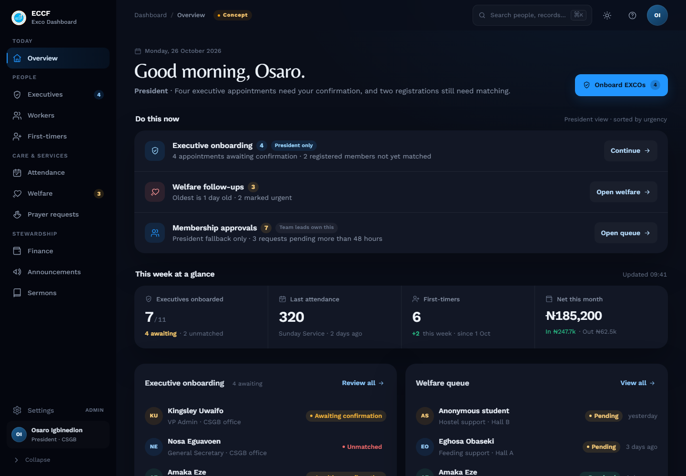
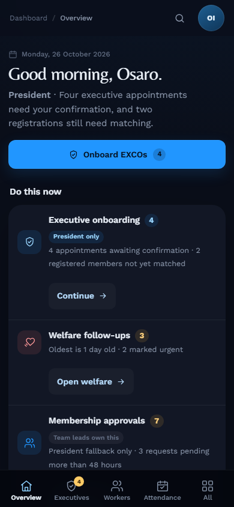

# ECCF EXCO Dashboard — Redesign Plan

**Direction:** a calm, attention-first executive cockpit  
**Status:** proposal for review · **Date:** 26 October 2026  
**Scope:** `eccf-frontend` → `app/(dashboard)`, `components/dashboard`  
**Constraints:** Next.js App Router · server components · streaming Suspense · RBAC · tokenized theming · mobile-first PWA · dark-mode default

> This document is a design and implementation plan, not the implementation. It assumes the existing data layer, auth, permissions, routes, and server actions stay intact. The job is to make the same system easier to read, prioritise, and act on.

### Contents

| Direction | Delivery |
|---|---|
| 1. [Executive summary](#1-executive-summary) | 8. [Mobile and responsive behaviour](#8-mobile-and-responsive-behaviour) |
| 2. [Objectives and success measures](#2-objectives-non-goals-and-success-measures) | 9. [Accessibility](#9-accessibility-and-inclusive-design) |
| 3. [Current-state audit](#3-current-state-audit) | 10. [Loading and trust](#10-loading-empty-error-and-trust) |
| 4. [Design direction](#4-design-direction) | 11. [Content and tone](#11-content-and-tone) |
| 5. [Design system](#5-design-system) | 12. [Implementation roadmap](#12-implementation-roadmap) |
| 6. [Navigation and IA](#6-information-architecture-and-navigation) | 13. [Measurement plan](#13-measurement-plan) |
| 7. [Page blueprints](#7-page-blueprints) | 14. [Open decisions](#14-open-decisions) |

---

## 1. Executive summary

The EXCO dashboard is functionally rich. The problem is not that it contains too much; it is that it presents almost everything at the same volume. A president opening `/dashboard` sees eight equal-weight statistic cards, each with its own repeated “View …” link. A workers page opens with two headings, two broadcast entry points, an email composer, an approval queue, and filters before the directory. Attendance puts its primary action below the fold. On mobile, Workers is **9.06 screens** tall.

That flatness is what people experience as “compact” and “tense”. The fix is not simply more whitespace. It is **hierarchy, progressive disclosure, and a smaller number of louder signals**.

### The three numbers that frame the work

| Signal | Current | Consequence |
|---|---:|---|
| Median text size on data pages | **12px** (6 of 10 desktop pages) | Users lean in, scan slower, and miss secondary context. |
| Workers scroll depth | **2.82×** desktop · **9.06×** mobile | The directory — the reason for the page — starts below the fold. |
| Controls under 44px | **94–100%** on most desktop pages | Every action is a precision tap, especially on phones. |

### The one-line direction

> **Quiet surface. Loud priorities.** Make the next decision obvious, make the data legible, and let everything else wait one layer down.

### The target experience

1. **In 5 seconds:** “What needs me now?”
2. **In 30 seconds:** “What is the state of the fellowship?”
3. **In 2 taps:** “Let me act on it.”

### What changes

- **Overview** becomes an attention queue followed by a four-metric pulse and two activity lists — not eight equal cards.
- **Every page** gets the same header, one primary action, a compact KPI strip, one toolbar, and one content region.
- **Navigation** becomes four permission-aware groups; mobile gets four role-prioritised tabs plus a proper “More” sheet.
- **Typography and controls** move to a 14px minimum for UI text and 44px targets for actions.
- **Colour** becomes semantic and restrained: tonal surfaces, one sky accent, status tints with words, no decorative color blocks.
- **Density** becomes a choice: a comfortable default, with an optional compact table mode for power users.

### What does not change

- Streaming server components and per-block `Suspense` + `BlockErrorBoundary`.
- RBAC, `hasPermission`, `canAccessSection`, and role-scoped queries.
- The `dashboard.css` HSL token system and the split Tailwind configs.
- Brand palette: navy, sky, gold. Brand fonts: Work Sans, Belleza, Geist Mono.
- The PWA shell, skip link, `<data>` figures, `aria-current`, and dark default.

---

## 2. Objectives, non-goals, and success measures

### Objectives

1. Reduce the time to the first meaningful action on every page.
2. Make the overview answer “what needs me?” before it shows inventory.
3. Establish one predictable page anatomy across all ten sections.
4. Raise legibility and touch accuracy without losing executive-level information density.
5. Reduce visual noise from borders, badges, hardcoded colours, and repeated CTAs.
6. Keep the dashboard fast, streamed, permission-correct, and theme-correct.

### Non-goals (this pass)

- New backend endpoints, schema changes, or a new notification service.
- Replacing the design system with another UI library.
- A marketing-style visual overhaul of the public site.
- New charting infrastructure. Phase 1 uses compact CSS bars/sparklines only if the data already exists.
- A full global search index. Search in the top bar is a Phase 2 enhancement; page-level search ships first.
- Changing authentication or the RBAC model.

### Success measures

| Area | Baseline | Target |
|---|---|---|
| Overview first action | Mixed; eight equal cards | A live attention item visible without scrolling at 1440×900 and 390×844 |
| Workers directory | Starts below fold; 2.82 desktop / 9.06 mobile screens | Table starts in first viewport at 1440; mobile page ≤4 screens |
| Attendance action | Submit below fold | “Record attendance” visible on load; form save always visible in sheet |
| Text legibility | Median 12px on 6/10 pages; 34–81% <14px | Median ≥14px desktop, ≥15px mobile; <15% of text below 14px |
| Tap targets | 94–100% under 44px on several pages | 100% of primary/nav controls ≥44px; ≥90% of all controls |
| Mobile page depth | Up to 9.06 screens | ≤3 screens for queue/detail pages; ≤4 for directories |
| Accessibility | Several 32–36px controls, placeholder-only search | WCAG 2.2 AA; zero critical axe findings; keyboard + screen-reader pass |
| Navigation | Flat 10-item list; mobile first four items | 2 taps to any permitted section; role-prioritised mobile tabs |
| Performance | Streaming already good | LCP <2.5s p75, INP <200ms, CLS <0.05 |
| Usability | No current baseline | 5 executive users, ≥90% task success, SEQ ≥5.5/7 |

**Measurement note:** targets are guardrails, not vanity metrics. The primary measure is task success on the five jobs below.

1. Find the oldest pending worker approval and approve it.
2. Record last Sunday’s attendance.
3. Find a first-timer and start a WhatsApp follow-up.
4. Resolve the oldest welfare request.
5. Find this month’s net position and one transaction.

---

## 3. Current-state audit

### 3.1 Method

- Source review of the dashboard routes, shell, primitives, and page clients.
- Live audit of the running app at **1440×1000**, **390×844**, and **320px** with mock auth (`eccf-dev-role=admin`).
- DOM measurements for text sizes, tap-target sizes, scroll depth, card counts, headings, and overflow.
- Screenshot review in dark and light themes.
- Heuristic review against the Vercel Web Interface Guidelines and WCAG 2.2 AA.

**Caveat:** one admin view, mock data, and a single reviewer. The direction is robust, but usability testing with real EXCO users is still required before build sign-off.

### 3.2 What already works and must be preserved

- **Streaming architecture.** The header paints immediately; each data block has its own skeleton and error boundary. This is better than most dashboards and should not be traded for client fetching.
- **RBAC is real.** Sections, stats, and links are filtered server-side; the skeleton is sized to the role’s card count.
- **Token foundation.** The dark palette is genuinely good: layered navy surfaces, readable muted text, a clear sky accent, and a calm canvas.
- **Accessibility intent.** Skip link, `<data>`, `aria-current`, status words, and icon-button labels are already present.
- **PWA shell.** Install flow, mobile bottom nav, and responsive shell exist.
- **Brand.** The navy/sky/gold palette and the Work Sans/Belleza pairing are distinctive. The problem is overuse, not the ingredients.

### 3.3 Measured baseline

**Desktop, 1440×1000**

| Page | Scroll depth | Median text | Text <14px | Controls <44px | Content height |
|---|---:|---:|---:|---:|---:|
| Overview | 1.21 | 14px | 35.7% | 96.2% | 1128px |
| Workers | **2.82** | **12px** | 56.2% | 97.4% | 2642px |
| Attendance | 1.94 | 12px | **80.7%** | 94.1% | 1813px |
| Finance | 1.03 | 14px | 34.5% | **100%** | 964px |
| First-timers | 1.00 | 12px | 50.4% | **100%** | 936px |
| Welfare | 1.27 | 14px | 40.4% | **100%** | 1193px |
| Prayer requests | 1.67 | 12px | 61.3% | **100%** | 1566px |
| Announcements | 1.18 | 12px | 65.0% | 97.4% | 1103px |
| Sermons | 1.21 | 14px | 37.2% | 96.3% | 1128px |
| Executives | 1.24 | 12px | 60.0% | 97.1% | 1158px |

**Mobile, 390×844**

| Page | Scroll depth | Median text | Text <14px | Controls <44px | Content height |
|---|---:|---:|---:|---:|---:|
| Overview | 2.75 | 14px | 45.1% | 70.0% | 2012px |
| Workers | **9.06** | **12px** | 56.1% | 92.5% | 6633px |
| Attendance | 4.92 | 12px | **81.7%** | 70.4% | 3605px |
| Finance | 2.58 | 14px | 34.3% | 61.5% | 1889px |
| First-timers | 3.00 | 12px | 50.4% | 85.7% | 2193px |
| Welfare | 2.70 | 14px | 40.0% | 72.2% | 1977px |

**Codebase signals**

| Pattern | Count | Reading |
|---|---:|---|
| `text-xs` | 373 | 12px is the default UI voice, not the exception. |
| `text-[10px]` / `text-[11px]` | 40 / 47 | Sub-legible labels and units. |
| Hardcoded `emerald` / `amber` / `rose` / `sky` | 134 / 123 / 41 / 52 | Parallel palette outside the token system. |
| `rounded-lg` / `rounded-xl` / `rounded-2xl` | 75 / 92 / 33 | Radius is applied by habit, not hierarchy. |
| `border-` utilities | 168 | “Borderless” direction is not consistently applied. |
| Cards on overview / executives / attendance | 18 / 13 / 15 | Card proliferation is the dominant composition pattern. |

At **320px** there is no horizontal overflow today. That is a real win to protect. The issue at 320 is not reflow; it is legibility and target size.

### 3.4 Findings

#### 1. Too many equal-weight blocks; no visual priority

The overview has 18 cards. People (5) and Finance (3) are rendered as the same card shape, at the same volume, with the same “View …” link. Workers stacks five modules before the directory. Attendance stacks four stats before the form. Prayer requests gives every request a full bordered card with a nested quote panel.

**Impact:** the user must scan everything to find the one thing that needs action. This is the primary source of “tension”.

#### 2. Type is below a comfortable reading size

The median is 12px on six of ten desktop pages. Attendance is 80.7% under 14px. Units (“records”, “attendees”, “peak”) and timestamps are 10–12px. Belleza headings are set at 18–20px with synthetic bold, where the face is at its thinnest.

**Impact:** users lean in, misread status and units, and the interface feels denser than it is. This is also an accessibility issue, not only a taste issue.

#### 3. Action targets are too small

Default buttons are 36px (`h-9`); small buttons are 32px; icon buttons are 28–36px; date quick-picks are 19px high. Desktop navigation rows are 40px. Most desktop pages report 94–100% of controls under 44px; mobile reports 61.5–92.5% on core pages.

**Impact:** every action requires precision. On a phone, in a service, this is the difference between “quick” and “fiddly”.

#### 4. Navigation is flat and not role-prioritised

Ten links are presented in one ungrouped list. Mobile bottom navigation takes the first four links in source order, then “More”, regardless of role. Pending approvals, welfare, and first-timer follow-ups have no visibility in navigation.

**Impact:** users learn the layout instead of the work. The most important destination for a president may be three taps away while a less-used section occupies a tab.

#### 5. Page anatomy is inconsistent

The TopBar renders an `h1` on every section; pages then render their own `h2`. Overview skips the TopBar title but has no `h2`. Workers renders **two `h1`s**. First-timers renders stat numbers as `h3`. Some pages have full-bleed header rules; others do not. Some use tables; others use card lists for the same kind of record.

**Impact:** the user cannot build a reliable mental model, and assistive technology gets a different outline on every page.

#### 6. Colour is doing decorative work

Finance uses saturated tinted cards and loud green/red amounts. First-timers uses a solid green WhatsApp button. Prayer and executives use visible borders and nested panels. Welfare uses a strong coloured left bar. 350+ hardcoded palette utilities sit outside the token system.

**Impact:** status colour competes with the brand accent, so nothing reads as urgent. It also creates dark-mode contrast risk and makes the redesign harder to maintain.

#### 7. Mobile is a long stack, not a mobile experience

Workers is nine screens. The approvals card is clipped behind the fixed bottom nav at 390px. Attendance’s primary action is below the fold. Overview’s 2-up stat grid breaks into a single orphan card. The bottom nav takes four fixed items and a “More” label.

**Impact:** the phone is the device people actually hold during service; today it is the worst place to do the work.

#### 8. Loading and transient states undermine the calm

`InitialPageLoader` holds a **white, light-themed overlay for 2.2 seconds** on hard loads, including in dark mode. A denied section redirects to the overview and shows a toast that overlaps the page title. Errors and denials use the same top-center toast language.

**Impact:** the first impression is a flash of the wrong theme, then a wait. The system feels less reliable than it is.

#### 9. Formatting is inconsistent across pages

Finance shows raw ISO dates (`2026-10-24`); attendance shows `25/10/2026`; announcements show `Thu, Oct 29, 2026`; overview uses relative days. Currency is rendered in three different ways, including a cramped naira glyph in Geist Mono.

**Impact:** users spend effort translating the interface. It also makes scanning across pages harder.

#### 10. Search, labels, and semantics need a pass

Search inputs rely on placeholders. Several icon buttons have no visible label. Table headers and mobile card fallbacks drift. Stat numbers are sometimes headings; page headings sometimes duplicate. Status pills sometimes use colour alone.

**Impact:** accessibility and screen-reader navigation suffer, and the interface is harder to learn.

### 3.5 The ten highest-leverage changes

| # | Change | Why it matters | Effort |
|---|---|---|---|
| 1 | Attention-first overview | Converts a report into a cockpit | M |
| 2 | One page template | Makes every page predictable | S |
| 3 | 14px minimum type scale | Immediately lowers tension | S |
| 4 | 44px controls | Makes touch and motor access reliable | S |
| 5 | Workers: tabs, not stacks | Fixes the worst page (2.82× / 9.06×) | M |
| 6 | Attendance: action-first form | Primary job becomes reachable | M |
| 7 | Tonal finance/status styling | Removes colour noise, fixes dark mode | S |
| 8 | Grouped, role-aware navigation | Puts priority destinations in reach | M |
| 9 | Theme-aware instant loader | Removes the white flash and 2.2s wait | S |
| 10 | Consistent date/currency/status formatting | Lowers translation effort everywhere | S |

---

## 4. Design direction

### 4.1 Concept: the executive cockpit

A cockpit is not a wall of gauges. It is a small number of calibrated signals, arranged by consequence. The ECCF dashboard should feel like a quiet operational surface with a few loud priorities — not a control room where every alarm is the same volume.

**Feel:** calm authority. Quiet navy, warm gold used sparingly, sky as the single action accent, generous tonal surfaces, crisp figures, no decorative lines.

**Reference behaviours, not visuals:** a morning brief, an approvals queue, a ledger, a care roster. Each page should feel like one of those objects, not like a grid of widgets.

### 4.2 Principles

1. **Attention before inventory.** Show what needs a decision before showing what exists.
2. **One page, one job.** Each section has one primary action and one dominant content region.
3. **Calm surface, loud data.** Surfaces recede; figures, names, and statuses advance.
4. **Readable by default.** 14px is the floor for UI text; 16px for reading text; 13px only for true metadata.
5. **Progressive disclosure.** Summary → list → detail drawer. Do not stack every module on the page.
6. **Thumb-first, not desktop-shrunk.** Mobile gets fewer tabs, bigger targets, sheets instead of dense forms, and cards instead of tables.
7. **Consistency is a feature.** The same header, toolbar, status language, date format, and row anatomy everywhere.
8. **Preserve the engine.** Streaming, RBAC, server components, and tokens are non-negotiable.

### 4.3 Before → after

| Before | After |
|---|---|
| 18 equal cards on the overview | 1 attention queue + 4 pulse metrics + 2 activity lists |
| 12px median UI text | 14px desktop / 15px mobile body; 13px metadata |
| 32–40px controls | 44px primary and nav controls; 40px minimum desktop |
| Saturated finance cards | One neutral KPI strip; colour only on deltas and status |
| Visible borders on cards | Tonal elevation; hairlines only in tables |
| Flat 10-item navigation | 4 groups, counts, role-aware mobile tabs |
| Two `h1`s and duplicate TopBar titles | One `h1` per page; breadcrumb in the TopBar |
| Workers’ five stacked modules | Three tabs: Directory / Approvals / Email |
| Attendance form below the fold | Action-first header + record sheet |
| 2.2s white loader | Instant shell + theme-aware skeletons |
| Repeated “View …” links | One stretched card link + section-level “View all” |
| Colour as decoration | Colour as meaning; status always in words |

### 4.4 Visual concept

A static overview concept is included to make the direction concrete. It is a design artifact, not production code.

- [`docs/design/exco-cockpit-concept.html`](design/exco-cockpit-concept.html)
- [`docs/design/exco-cockpit-concept-desktop.png`](design/exco-cockpit-concept-desktop.png)
- [`docs/design/exco-cockpit-concept-mobile.png`](design/exco-cockpit-concept-mobile.png)





The concept demonstrates the attention queue, the four-metric pulse, the grouped navigation, the single page title, and the restrained status treatment. It is intentionally a single page; the page blueprints in §7 carry the same language into the other nine sections.

### 4.5 Density strategy

Do not force one density on everyone.

- **Comfortable (default):** 14–15px body, 48px table rows, 20–24px card padding.
- **Compact (desktop tables only):** 13px table text, 40px rows, 12px cell padding. A toggle in the table toolbar, persisted in a cookie.
- **Never compact on mobile.** Mobile always uses the comfortable scale and card/list fallbacks.

This resolves the apparent conflict between “executives want a lot on screen” and “the dashboard feels cramped”: give power users a deliberate compact mode, and keep the default calm.

---

## 5. Design system

### 5.1 Colour and surfaces

Keep the existing brand and token architecture. The work is to make the **surface scale explicit** and the **semantic use disciplined**.

**Dark theme (default)**

| Role | Token | HSL | Approx. | Use |
|---|---|---|---|---:|
| Canvas | `--background` | `222 47% 7%` | `#0a0e19` | App background |
| Surface 1 | `--card` | `222 38% 10%` | `#121725` | Cards, panels |
| Surface 2 | `--popover` | `222 40% 12%` | `#161b2a` | Menus, sheets, hover |
| Surface 3 | new `--surface-raised` | `220 30% 15%` | `#1b2233` | Selected rows, nested panels |
| Hairline | `--border` | `220 22% 16.5%` | `#212733` | Table rules, input edges only |
| Text | `--foreground` | `216 28% 88%` | `#d8e0ea` | Primary text |
| Muted | `--muted-foreground` | `215 16% 62%` | `#8d99ad` | Metadata, captions |
| Accent | `--primary` | `205 100% 55%` | `#2196ff` | One action per view, active nav |
| Success | `--success` | `155 65% 48%` | — | Positive delta, resolved |
| Warning | `--warning` | `38 95% 56%` | — | Pending/attention, with words |
| Danger | `--destructive` | `0 70% 58%` | — | Destructive action, deficit |
| Brand gold | new `--gold` | `38 92% 50%` | `#f59e0b` | Identity, pinned marker only |

**Light theme**

| Role | Token | HSL | Approx. |
|---|---|---|---:|
| Canvas | `--background` | `60 9% 98%` | `#fafaf9` |
| Surface 1 | `--card` | `0 0% 100%` | `#ffffff` |
| Surface 2 | `--popover` | `210 40% 97%` | `#f6f8fb` |
| Hairline | `--border` | `214 32% 91%` | `#e2e8f0` |
| Text | `--foreground` | `222 42% 6%` | `#090d16` |
| Muted | `--muted-foreground` | `215 16% 42%` | `#5b6676` |
| Accent | `--primary` | `205 100% 40%` | `#0077cc` |
| Success | `--success` | `161 94% 30%` | `#059669` |
| Warning | `--warning` | `38 92% 50%` | `#f59e0b` |
| Danger | `--destructive` | `0 72% 51%` | `#dc2626` |

**Rules**

- **Tonal elevation, not outlines.** Cards use surface steps + a whisper of shadow in light mode; no `border-*` on new cards. Table rows may use `border-border/50` hairlines.
- **One accent per view.** Primary sky is for the page’s primary action, active nav, links, and focus. It is not a decorative fill.
- **Status = tint + icon + word.** `bg-success/10 text-success` with “Resolved”, never a solid green block and never colour alone.
- **Gold is identity, not status.** It appears in the logo, exco/pinned markers, and celebratory moments. It never means “warning”.
- **No coloured left bars** on cards. Use a status chip and a tonal surface.
- **Contrast:** 4.5:1 for body, 3:1 for large text and UI boundaries. Verify every tinted pair in both themes.

Add `--surface-raised` and `--gold` to `dashboard.css` and the dashboard Tailwind config; do not add a parallel palette. Replace hardcoded `emerald` / `amber` / `rose` / `sky` utilities with token-based classes.

### 5.2 Typography

The current fonts are a strength. The problem is role drift: Belleza appears at 18px section headings with synthetic bold, and 10–12px labels carry too much information.

| Role | Font | Desktop | Mobile | Weight | Notes |
|---|---|---|---|---:|---|
| Page title | Belleza | 32/38 | 28/34 | 400 | One per page; no synthetic 700. |
| Eyebrow / context | Work Sans | 12/16 | 12/16 | 600 | Uppercase, 0.08em, muted. Use sparingly. |
| Section title | Work Sans | 18/24 | 16/22 | 600 | Tables, panels, activity sections. |
| Card title | Work Sans | 15/20 | 15/20 | 600 | Not a heading unless the card is a landmark. |
| Body | Work Sans | 14/22 | 15/23 | 400 | The default reading size. |
| Meta | Work Sans | 13/18 | 13/18 | 400 | Timestamps, captions, units. |
| Table text | Work Sans | 14/20 | 14/20 | 400 | Compact mode: 13/18. |
| Button | Work Sans | 14/20 | 15/20 | 600 | Sentence case, imperative verb. |
| Badge | Work Sans | 13/16 | 13/16 | 500 | Tint + word; no 10–11px badges. |
| Figure XL | Work Sans | 36/40 | 32/36 | 700 | `tabular-nums`; overview pulse / finance net. |
| Figure M | Work Sans | 24/28 | 24/28 | 600 | KPI strip, compact stats. |
| Reference | Geist Mono | 13/18 | 13/18 | 400 | IDs, transaction refs, codes. Never currency. |

**Rules**

- **13px floor for content.** Remove every `text-[10px]` and `text-[11px]`. Reserve 12px for uppercase group labels and mobile tab labels; never use it for body, metadata, units, badges, or controls.
- **One display face, one job.** Belleza is for page titles and a single welcome moment. It is never used for section headings, table headers, or card titles.
- **Belleza at 400 only.** The family has no true bold; synthetic bold makes it smeared at small sizes.
- **Currency uses Work Sans**, not Geist Mono. The naira glyph is cramped in the mono face. Use `font-variant-numeric: tabular-nums`.
- **Sentence case.** “Record transaction”, “Review approvals”, “First-timers” — not “Record Transaction” or “PRESIDENTIAL WORKFORCE CRM”.
- **Balance headings, pretty body.** `text-wrap: balance` on page/section titles; `text-wrap: pretty` on prose.
- **Line length:** 60–75ch for prose and descriptions; tables may run full width.

### 5.3 Spacing, grid, and layout

- **Base unit:** 4px.
- **Page padding:** 32px desktop, 24px tablet, 16px mobile. Optional 40px at ≥1536px.
- **Section gap:** 32px desktop, 24px mobile.
- **Grid:** 12 columns, 24px gutters, max content width **1280px**. Tables may use the full content width; prose stays ≤75ch.
- **Card padding:** 20–24px desktop, 16–20px mobile.
- **Table cell padding:** 12px vertical × 16px horizontal; row height 48px comfortable / 40px compact.
- **Control heights:** 44px mobile, 40px desktop minimum; icon buttons 44px on mobile.
- **Sidebar:** 240px expanded, 68px collapsed. Keep the cookie-based first paint.
- **Top bar:** 64px desktop, 56px mobile. One row; no duplicate page title.

**Vertical rhythm for a data page**

```
TopBar breadcrumb / utilities          56–64px
Page header (eyebrow, h1, description, primary action)   96–120px
KPI strip (optional)                   72–88px
Toolbar (search, filters, view)        56px
Content                                remaining
```

The first data row should be visible by ~360–420px from the top of the content area at 1440×900.

### 5.4 Radius and elevation

| Token | Value | Use |
|---|---:|---|
| `--radius-control` | 10px | Buttons, inputs, selects |
| `--radius-card` | 16px | Cards, KPI tiles |
| `--radius-panel` | 20px | Sheets, dialogs, large panels |
| `--radius-pill` | 999px | Status pills, filter chips |

- No shadows on cards in dark mode; use surface contrast.
- Light mode: `0 1px 2px rgb(9 13 22 / 0.06)` maximum on cards.
- Popovers/sheets: `0 24px 64px rgb(0 0 0 / 0.35)`.
- Sticky toolbar: `0 1px 0 hsl(var(--border) / 0.5)` rather than a heavy shadow.
- Stop using `rounded-2xl` by habit. Radius should communicate object type, not decorate every rectangle.

### 5.5 Component specifications

| Component | Specification |
|---|---|
| **Button** | 44px mobile / 40px desktop; 14–15px semibold; 16px icon; primary = sky fill; secondary = `bg-secondary` tonal; ghost = no fill; danger = destructive tint. Loading spinner + disabled. One primary per view. |
| **Icon button** | 44×44 mobile / 40×40 desktop; 20px icon; always `aria-label`; tooltip on desktop. |
| **Input / Select / Search** | 44px; visible `<label>` (or `sr-only` + persistent hint); 16px font on mobile to avoid iOS zoom; 14px desktop; error text below with `aria-describedby`; no placeholder-only labels. |
| **Page header** | Eyebrow (optional), `h1`, one-sentence description, primary action, secondary actions in a menu. No duplicate title. |
| **KPI strip** | 2–4 compact tiles on one tonal panel; label 13px, figure 24–36px, caption 13px; one stretched link per tile; no repeated CTA text. |
| **Stat card** | Only for true headline numbers. Label 13–14px, figure 32–40px, caption 13px. No card unless it is the primary focal point. |
| **Table** | 14px text, 48px rows, sticky header, `caption` (sr-only), `scope="col"`, right-aligned numerics, `tabular-nums`, sortable `aria-sort`, row menu for secondary actions. |
| **Mobile record card** | 16px title, 13px meta, 2-line clamp, status chip, one primary action + overflow; 64–72px minimum height; chevron for detail. |
| **Status badge** | 13px; tinted background; icon or dot; explicit word. Variants: neutral, info/primary, success, warning, danger. |
| **Filter bar** | Desktop: 44px search + 2–3 selects + reset. Mobile: one “Filters (n)” button opening a bottom sheet; active filters shown as removable chips. |
| **Tabs / segmented control** | 44px; counts in labels; URL-backed (`?tab=`), `aria-current="page"` or proper tab semantics. |
| **Sheet / drawer** | 480px desktop; full-screen mobile; sticky header and footer; focus trap; Escape; restore focus. |
| **Empty state** | Icon, one sentence, one action. No decorative illustration unless it clarifies. |
| **Skeleton** | Exactly matches final layout; `aria-hidden`; one live-region announcement per block, not per shimmer. |
| **Toast** | Bottom-right desktop, above bottom nav mobile; `role="status"` / `aria-live="polite"`; critical errors inline, not toast-only. |

### 5.6 Motion and feedback

- Standard transition: **150ms** ease-out; sheets/dialogs **200ms**.
- No parallax, no continuous shimmer beyond skeleton loading, no auto-playing motion.
- Respect `prefers-reduced-motion`; disable transforms and shimmer, keep instant state changes.
- Row hover: surface step + 120ms; do not lift cards with shadows on hover.
- Buttons: pressed scale 0.98 or background shift; never both.
- Loading: skeleton first, spinner only inside the action that is pending.
- Destructive actions: confirmation dialog with the object named; undo only for reversible actions.

### 5.7 Data formatting

Centralize in `lib/dashboard/format`:

| Type | Format | Example |
|---|---|---|
| Date (full) | `d MMM yyyy` | `24 Oct 2026` |
| Date (short) | `d MMM` | `24 Oct` |
| Relative | `formatRelativeDay` with absolute date in `title` | `2 days ago` |
| Currency | `Intl.NumberFormat('en-NG', { currency: 'NGN', maximumFractionDigits: 0 })` | `₦247,700` |
| Large count | `Intl.NumberFormat('en-NG')` | `1,240` |
| Percentage | one decimal max | `12.4%` |
| Reference | Geist Mono, uppercase preserved | `FLW-8K2M` |

Never ship raw ISO dates in the UI. Never render currency in the mono face. Use `<time dateTime>` and `<data value>` consistently.

---

## 6. Information architecture and navigation

### 6.1 Grouped sidebar

Ten flat links become four groups. The grouping is stable across roles; RBAC removes items the role cannot open.

| Group | Items |
|---|---|
| **Today** | Overview |
| **People** | Executives · Workers · First-timers |
| **Care & services** | Attendance · Welfare · Prayer requests |
| **Stewardship** | Finance · Announcements · Sermons |

**Details**

- Group labels: 12px, 600, uppercase, 0.08em, muted; 24px top margin; not links.
- Item rows: 44px; 18px icon; 14px label; active = `bg-sidebar-accent` tonal pill + sky icon/text.
- Optional count badge right-aligned: 20px pill, 12px bold, only when count > 0; cap at `99+`.
- Badges must be server-derived and permission-filtered. Do not invent counts in the shell.
- Collapsed rail: 68px; icons centered; tooltips on hover/focus; group labels hidden; active item retains the tonal pill.
- Sidebar footer: one theme entry point (inside UserMenu), Help, Collapse. No duplicated controls.

### 6.2 Top bar

**Desktop**

```
[ECCF mark]  Dashboard / Finance                         [Search ⌘K]  [Avatar ▾]
```

- Breadcrumb is navigation, not a heading. Current page is `aria-current="page"`, muted.
- Remove the duplicate `h1` from the TopBar. The page owns the only `h1`.
- Search is a 40px button with a visible placeholder-style label until Phase 2; pressing opens a command/search dialog (people, workers, refs, pages).
- PWA install moves into the UserMenu/More sheet; it is not a permanent primary action.
- UserMenu: role, team, theme, install, help, sign out.
- One theme toggle in UserMenu; one in mobile More. Remove the third.

**Mobile**

```
[ECCF]                                      [Search]  [Avatar]
```

- Page title appears in the page header immediately below, not in the top bar.
- No install button in the top bar.
- 56px height; 44px targets; no horizontal overflow at 320px.

### 6.3 Mobile bottom navigation

Five destinations, **role-prioritised**, plus More. The current “first four in source order” approach is replaced by an explicit map.

| Role | Tab 1 | Tab 2 | Tab 3 | Tab 4 | Tab 5 |
|---|---|---|---|---|---|
| `admin` | Overview | Workers | Attendance | Finance | More |
| `team_lead` | Overview | Workers | Attendance | First-timers | More |
| `finance` | Overview | Finance | Attendance | Announcements | More |
| `hall_rep` | Overview | First-timers | Attendance | Welfare | More |

- 56px bar + safe area; 12px labels; 20px icons; 44px touch area.
- Active item: sky icon + label, subtle top indicator or tonal pill — no border line.
- Badge dot/count on Workers/Finance/Welfare only when a real pending count exists.
- **One** bottom compensation mechanism. Keep the `pb` on main and remove the extra spacer in `BottomNav`, or vice versa. Verify sheets and dialogs clear the nav.
- More sheet: grouped links, theme, install, help, sign out; 48px rows; scrollable; focus trap; `overscroll-behavior: contain`.

### 6.4 Page template

Every section uses the same anatomy:

```
┌ TopBar: breadcrumb · search · avatar ──────────────────────────────┐
│                                                                    │
│  EYEBROW (optional)                         [Secondary] [Primary]  │
│  Page title                                                        │
│  One sentence that explains the job.                               │
│                                                                    │
│  ┌ KPI strip: 2–4 compact figures ─────────────────────────────┐   │
│  └──────────────────────────────────────────────────────────────┘   │
│                                                                    │
│  [ Search ……………………… ] [Filter] [Filter] [View]   [Reset]          │
│                                                                    │
│  ┌ Primary content: table / list / queue ───────────────────────┐   │
│  │                                                               │   │
│  └───────────────────────────────────────────────────────────────┘   │
│                                                                    │
│  Pagination / load more / result count                             │
└────────────────────────────────────────────────────────────────────┘
```

**Rules**

- One `h1`; section headings are `h2`; card/row titles are `h3` only when they are landmarks. Do not use heading tags for visual size.
- Primary action first in the action group; secondary actions in a “More” menu.
- KPI strip is optional. If a number does not change a decision, it does not deserve a tile.
- Toolbar sits below the KPI strip, not above the page title.
- The primary content starts within the first viewport on desktop.
- Empty/loading/error states occupy the content region, not the whole page.

### 6.5 Search and command palette (Phase 2)

- A global `⌘K` / `Ctrl K` dialog searches pages, people, workers, finance references, and announcements.
- It is a client shell component, but results come from a server search endpoint or pre-filtered server data; it must respect RBAC.
- Empty query shows recent pages and role-relevant quick actions.
- Mobile: a full-screen search sheet from the top-bar search button.
- Do not ship a fake search box. If the index is not ready, use page-level search only.

### 6.6 Badges and counts

- Counts come from the same server queries as the pages; no client-side guesswork.
- Badge semantics: “7 pending approvals” not just “7”.
- Zero counts hide the badge, not show “0”.
- Screen-reader label includes the meaning: `aria-label="Workers, 7 pending approvals"`.
- Avoid red dots for non-critical counts. Use warning tint for pending, neutral for informational.

---

## 7. Page blueprints

Each blueprint states the current problem, the redesign, and the acceptance bar.

### 7.1 Overview — “what needs me now”

**Current:** greeting, a Mail All Workers CTA, 5 People cards + 3 Finance cards, then two recent lists. Eight equal cards, five across at 1152px, labels wrapping, every card repeating “View …”. The bulk-mail action is visually promoted above actual approvals.

**Redesign**

```
┌ Good morning, Osaro                          Wednesday, 29 October ┐
│ President · Sunday Service in 4 days                                │
│ 3 things need your attention.                                       │
│                                                                     │
│ NEEDS YOU NOW                                                       │
│ ┌─────────────────────────────────────────────────────────────────┐ │
│ │ Worker approvals        7   oldest 3 days   [Review approvals →]│ │
│ │ Welfare requests        3   oldest 1 day    [Open welfare →]    │ │
│ │ Prayer follow-ups       3   this week       [Open prayer →]     │ │
│ └─────────────────────────────────────────────────────────────────┘ │
│                                                                     │
│ THIS WEEK                                                           │
│ [ Attendance 320 ] [ First-timers 6 ] [ Workers 31 ] [ Net ₦185,200]│
│                                                                     │
│ Recent first-timers                    Recent welfare requests      │
│ … 4 rows …                             … 4 rows …                   │
└─────────────────────────────────────────────────────────────────────┘
```

**Layers**

1. **Brief (static, immediate):** time-aware greeting, role, date, and one sentence of context. No badge soup. The role appears as quiet text, not a pill.
2. **Attention queue (streamed):** up to three actionable items, sorted by consequence and age. Each row has a count, age, one-sentence why, and a 44px action. If empty: “You’re all caught up” plus the next service.
3. **Pulse (streamed):** four metrics only — last attendance, first-timers this month, verified workers, net this month. One tonal panel, compact tiles. Each tile is a stretched link; no repeated “View” text.
4. **Activity (streamed):** two columns, four rows each, “View all” once per section header. No nested cards; rows separated by hairlines.

**Actions**

- Primary: “Review approvals” when count > 0; otherwise “Record attendance” for relevant roles; otherwise the highest-priority permitted action.
- Secondary: “Mail workers” moves into the Workers page and the action menu. It is not the hero CTA.
- No “Install App” in the hero.

**Streaming**

- Brief renders immediately.
- Attention queue, pulse, and each activity list have their own `Suspense` + `BlockErrorBoundary`.
- Skeletons match the new exact heights. Keep one live-region announcement for stats.

**Acceptance**

- At 1440×900 and 390×844, the first attention row is visible without scrolling.
- No card row exceeds four tiles.
- One `h1`; section titles are `h2`.
- No repeated “View …” link inside a card.

---

### 7.2 Workers — directory, approvals, email

**Current:** two `h1`s, “Broadcast Mail” plus a full email dispatcher, a pending-approval roster, filters, then the directory. 2.82 desktop / 9.06 mobile screens. The approval card is clipped by the bottom nav on mobile.

**Redesign**

- Title: **Workers**. Subtitle: “Directory, approvals, and team communications.”
- Header actions: **Add worker** (primary), **Email workers** (secondary), overflow: Import CSV, Export.
- KPI strip: Total 31 · Verified 24 · Pending 7. One strip, not five cards.
- Tabs: **Directory (31)** · **Approvals (7)** · **Email**.
  - Default to **Approvals** for `admin` when pending > 0; otherwise Directory.
  - URL-backed: `?tab=approvals`.
- Directory: toolbar (search, team, hall, status), table with Name, Team/Department, Hall, Status, Registered, row menu. Sticky header. 48px rows.
- Approvals: list of candidates with name, requested role, hall/team, age, and two actions: **Review** (primary) and overflow. Review opens a detail drawer with the full request and Approve/Reject. Do not put a large solid green button on every row.
- Email: one composer with audience count, template, subject, preview, and a send confirmation. No duplicate “Broadcast Mail” entry point.
- Mobile: tabs; approvals as cards with a 44px Review action; directory as compact cards; search/filter in a bottom sheet.

**Acceptance**

- One `h1`; one primary action; one email entry point.
- Directory table begins in the first viewport at 1440×900.
- Mobile page ≤4 screens; no content hidden behind the bottom nav.
- Approve/reject requires a confirmation that names the person and the permission effect.

---

### 7.3 Attendance — action first

**Current:** four stat cards with tiny units, tabs, then a form whose submit action is below the fold. Date quick-picks are 19px high. The page uses `25/10/2026` while finance uses ISO dates.

**Redesign**

- Title: **Attendance**. Subtitle: “Record service headcounts and manage team rosters.”
- Primary: **Record attendance** opens a right drawer (desktop) or full-screen sheet (mobile).
  - Fields: service date, service type, headcount, optional roster/notes.
  - Sticky footer: Cancel / Save. 44px controls. Date picker with Today / Last Sunday / Last Wednesday as 44px chips.
  - Save returns to the history with a success toast and a brief success highlight after the server confirms.
- KPI strip: Services counted 10 · Sunday average 334 · Last service 320. Remove “Highest peak” unless it drives a decision; put the trend in the history header.
- Tabs: **General headcount** · **Team rosters**.
- History: table with Date (24 Oct 2026), Service, Headcount, Recorded by, Actions. Optional 8-week CSS bar strip above the table, no chart library.
- Mobile: the “Record attendance” action is visible in the header; the record sheet is full-screen; history is cards.

**Acceptance**

- Record action is visible on load at 1440×900 and 390×844.
- Every date/quick-pick control ≥44px.
- Save is always visible in the sheet footer (sticky).
- Dates match the global format; no raw ISO.

---

### 7.4 Finance — a ledger, not a colour block

**Current:** three saturated tinted stat cards, raw ISO dates, loud green/red amounts, 36px filters, 32px actions, and a cramped naira glyph in mono.

**Redesign**

- Title: **Finance**. Subtitle: “Income, expenses, and the monthly position.”
- Primary: **Record transaction**. Secondary: Export CSV (overflow on mobile).
- KPI strip: Income ₦247,700 · Expenses ₦62,500 · Net ₦185,200. One neutral panel; a small trend icon and tinted delta only. No green/red card backgrounds.
- Toolbar: search, type, month, reset. 44px. Active filters as removable chips.
- Table: Date (24 Oct 2026), Description, Type (tinted badge), Reference (mono 13px), Amount (right-aligned, tabular, sign +/−, colour only as reinforcement), Actions.
- Footer: count and total; pagination.
- Mobile: cards with type, amount, date, description, reference; filters in a sheet.

**Acceptance**

- No raw ISO dates.
- Amounts use one formatter; no mono currency.
- Colour is never the only indicator of income/expense.
- Table is visible in the first viewport; no horizontal scroll at 390px.

---

### 7.5 First-timers — a follow-up queue

**Current:** eight full cards, 12px metadata and phone numbers, 36px call/WhatsApp/copy controls, stat numbers marked as `h3`, a hardcoded green WhatsApp button.

**Redesign**

- Title: **First-timers**. Subtitle: “Follow up with every new person within 48 hours.”
- KPI strip: This month 6 · Awaiting follow-up (if available) · Halls reached 5.
- Tabs or filter: **All** · **Needs follow-up** · **Contacted**. Default to Needs follow-up when the count is non-zero.
- Toolbar: search, hall, level, status.
- Desktop table: Name, Hall/Level, Phone, First visit, Follow-up, Actions. 48px rows. Phone is selectable and copyable.
- Actions: one primary **WhatsApp** button and one 44px **Call** icon; **Log follow-up** in the row menu. No solid green brand button.
- Detail drawer: profile, notes, assigned leader, contact history, mark contacted.
- Mobile: cards with name, hall/level, 2-line meta, status, WhatsApp primary + call icon; 44px.
- Privacy: phone numbers only for permitted roles; no phone numbers in analytics or logs.

**Acceptance**

- No 36px contact actions.
- Follow-up status is visible without opening a record.
- Search has a visible label and a 44px field.
- The page does not exceed 3 screens on mobile.

---

### 7.6 Welfare — a care queue

**Current:** coloured stat cards, strong left bars, request cards with “Mark Resolved” repeated on every row, 2.7 mobile screens.

**Redesign**

- Title: **Welfare**. Subtitle: “Review requests, respond with care, and close the loop.”
- KPI strip: Pending 3 · Resolved this month (if data) · Median response time (only if tracked).
- Tabs: **Pending (3)** · **Resolved** · **All**. Default Pending.
- Request list: requester (or “Anonymous student”), hall, need category, age, priority, assigned to, status. Primary action **Open case**; resolution happens in the detail drawer with notes and a confirmation.
- Detail drawer: full request, contact, timeline, internal notes, resolve with outcome. No public exposure.
- Remove coloured left bars; use a small “Urgent” chip with icon and text.
- Mobile: queue cards, 44px Open; no more than 2 screens to the oldest request.

**Acceptance**

- The queue, not the stats, is the first content.
- “Resolve” is not a one-tap action on a list row.
- Priority is text + icon, not colour alone.
- Empty state: “No pending requests” with a link to resolved.

---

### 7.7 Prayer requests — a calm feed

**Current:** three stat cards, a heavy filter row, bordered cards with nested quote panels, 1.67 desktop screens for five requests.

**Redesign**

- Title: **Prayer requests**. Subtitle: “A quiet feed for intercession and follow-up.”
- KPI strip: This week 3 · Named vs anonymous as a compact summary. Keep it to two signals.
- Toolbar: search, filter (All / This week / Named / Anonymous), sort. 44px; mobile filters in a sheet.
- Feed: one tonal surface per request; no nested borders. Quote text 15–16px / 1.6. Header: name or “Anonymous”, relative time with absolute title, category.
- Actions: **Copy** and **Open**; if a “prayed” state exists, **Mark prayed** with an undo. Do not invent a “pray” action if the data model does not support it.
- Pagination: 10 per page + “Load more” (44px), not infinite scroll.
- Empty state with a gentle prompt.
- Privacy: anonymous requests never expose identifying metadata; no content in analytics.

**Acceptance**

- A request is readable at arm’s length; quote text ≥15px.
- No nested bordered boxes.
- Filter state is obvious and resettable.
- Mobile feed ≤3 screens for 5 requests.

---

### 7.8 Announcements — a publishing queue

**Current:** three equal cards in a row, a fourth draft orphaned below, category colors, filter pills, 65% of text under 14px.

**Redesign**

- Title: **Announcements**. Subtitle: “Plan, schedule, and broadcast notices.”
- Primary: **New announcement**.
- Status filters: **All** · **Live** · **Drafts**; pinned items sort first, with a **Pinned** filter chip when needed (44px).
- Content: a list/table, not a three-card grid.
  - Desktop rows: Status (Live/Draft/Pinned), Title, Category, Date/time, Venue, Broadcast state, Actions.
  - Pinned rows first with a pin icon.
  - Row click opens a preview/detail drawer.
- Broadcast: one action; confirmation names the audience count. “Resend” lives in the overflow with a confirmation.
- Delete: destructive confirmation with the title.
- Mobile: cards with status, title (2-line clamp), date/time, broadcast state, actions in a sheet.
- Drafts are a filter, never an orphan card at the bottom.

**Acceptance**

- The list scans in one pass; no equal-weight card grid.
- Status and broadcast state are words, not just colours.
- Create, edit, broadcast, and delete have clear primary/secondary hierarchy.
- Mobile page ≤3 screens for 4 announcements.

---

### 7.9 Sermons — consistent media list

**Current:** the admin route redirects to the overview with a top-center “You don’t have access” toast that overlaps the page title. The content itself is a conventional list.

**Redesign**

- Title: **Sermons**. Subtitle: “Publish and manage service recordings.”
- Primary: **Upload sermon**. Secondary: series filter.
- Table/list: Title, Speaker, Series, Date, Status, Actions. 48px rows.
- Mobile: cards with title, speaker, date, status; actions in a sheet.
- **Access denied:** render a dedicated in-dashboard “No access” state with the reason, a link back to Overview, and no toast over the title. Do not redirect to a different page’s content and leave the URL ambiguous.
- If the role cannot see the section, it does not appear in navigation.

**Acceptance**

- Denied access has a stable URL and a clear state.
- No toast overlaps the `h1`.
- Content uses the same list/table anatomy as Announcements.
- Mobile upload flow is a full-screen sheet.

---

### 7.10 Executives — an appointments queue

**Current:** a dense console with four stat chips, category pills, repeated full-width solid green “Approve Appointment” buttons, and candidate cards. 60% of text under 14px.

**Redesign**

- Title: **Executives**. Subtitle: “Appointments and leadership roster.”
- Header actions: **Import from spreadsheet** (secondary), **Add appointment** (primary).
- KPI strip: Total 6 · CSGB 2 · Halls 2 · Teams 2. One neutral strip.
- Tabs: **Pending (6)** · **Appointed** · **All**. Category filters: CSGB offices · Hall pastors · Team leads. Counts in labels.
- Pending list rows: initials avatar, name, requested role, scope (hall/team), submitted date, status. Primary **Review**; overflow for reject.
- Review drawer: full request, role scope, permission effect (“Approving grants verified membership on Team X”), note, Approve/Reject. Confirmation required.
- Current roster: same row anatomy, status “Appointed”, actions in overflow.
- Mobile: queue cards; drawer footer sticky; 44px actions.

**Acceptance**

- No repeated solid-green approve blocks on every row.
- Approval effect is explained before confirmation.
- Pending is the default tab for authorized approvers.
- One `h1`; dates formatted consistently.

---

## 8. Mobile and responsive behaviour

### 8.1 Breakpoints

| Name | Width | Behaviour |
|---|---:|---|
| Base | 320–639 | Single column, bottom nav, cards, full-screen sheets |
| `sm` | 640–767 | 2-column KPI grid, wider cards |
| `md` | 768–1023 | Tablet: 2-column content, sidebar still hidden |
| `lg` | 1024–1279 | Sidebar appears; tables may appear |
| `xl` | 1280–1535 | Full 12-column layout |
| `2xl` | ≥1536 | Content capped at 1280px |

Test every page at **1440×900**, **1024×768**, **768×1024**, **390×844**, and **320×568**.

### 8.2 Mobile page budgets

| Page | Target |
|---|---:|
| Overview | ≤2 screens to the end of activity |
| Workers | ≤4 screens |
| Attendance | ≤3 screens; form in sheet |
| Finance | ≤3 screens |
| First-timers | ≤3 screens |
| Welfare | ≤2.5 screens |
| Prayer | ≤3 screens for 5 requests |
| Announcements | ≤3 screens for 4 items |
| Executives | ≤3 screens for 6 candidates |

These are design budgets, not hard limits for search results or long lists. Lists paginate; they do not become 9-screen stacks.

### 8.3 Mobile rules

- **Bottom nav:** 56px + safe area; 5 items; role-prioritised; one spacer; `pb` on main; no clipping.
- **Primary actions:** visible in the page header; for record/create flows, a full-screen sheet with a sticky footer.
- **No floating action buttons** over lists; they obscure content and compete with the bottom nav.
- **Tables become cards** with 3–4 key fields, 16px title, 13px meta, 44px action, chevron.
- **Filters** collapse into one “Filters (n)” button + bottom sheet with Apply/Reset. Show active chips.
- **Search** is a full-width 44px field with a visible label; on tapping the top-bar search, open a full-screen search sheet.
- **Touch:** `touch-action: manipulation` on primary links; no hover-only actions.
- **Inputs:** 16px font on mobile; `inputmode` for phone/amount; autocomplete where appropriate.
- **Safe areas:** bottom padding uses `env(safe-area-inset-bottom)` once.
- **320px:** no horizontal scroll; no fixed-width tables; truncate with `title` where needed.
- **PWA install:** in More/UserMenu, not the top bar.
- **Theme:** UserMenu + More only; no third toggle.

---

## 9. Accessibility and inclusive design

**Standard:** WCAG 2.2 Level AA.

### 9.1 Non-negotiables

- **Text:** 14px minimum for UI, 15–16px for reading, 13px only for metadata. No 10–11px text.
- **Contrast:** 4.5:1 body; 3:1 large text and UI boundaries; verify every tinted status pair in both themes.
- **Target size:** 44×44px for primary/nav controls; 40px minimum desktop; inline text links exempt but surrounded by adequate spacing.
- **Focus:** 2px ring + 2px offset; `:focus-visible`; never remove outlines.
- **Headings:** one `h1`; `h2` for sections; `h3` for row/card landmarks; no heading tags for visual size.
- **Labels:** every input has a visible label or a persistent `sr-only` label plus hint; no placeholder-only labels.
- **Status:** words + icon + tint; never colour alone.
- **Errors:** inline, associated with the field, announced; a summary at the top of long forms.
- **Streaming:** `aria-busy` on the region; one polite announcement per block; skeletons `aria-hidden`.
- **Toasts:** `role="status"` or `alert`; dismissible; critical errors inline.
- **Dialogs/sheets:** focus trap, Escape, restore focus, labelled by title.
- **Tables:** `<caption>` (may be `sr-only`), `scope`, `aria-sort` on sortable headers, row headers where appropriate.
- **Navigation:** `aria-current="page"`, `aria-label` on nav landmarks, skip link first in tab order.
- **Motion:** respect `prefers-reduced-motion`; no auto-playing motion.
- **Zoom/reflow:** usable at 200% zoom and 320px width without loss of content.
- **WCAG 2.2 specifics:** focus not obscured by sticky bars (2.4.11); no drag-only interaction (2.5.7); consistent help (3.2.6); redundant entry avoided in forms (3.3.7).

### 9.2 Test matrix

| Test | Method |
|---|---|
| Automated | axe-core on every page in dark and light; zero critical/serious |
| Keyboard | Tab/Shift+Tab through shell, nav, table, drawer, filters; no traps |
| Screen reader | VoiceOver (iOS) + NVDA (Windows) on overview, workers, attendance, finance |
| Zoom | 200% at 1440 and 1024 |
| Reflow | 320px width, all pages |
| Reduced motion | OS setting; no shimmer/transform |
| Forced colors | Windows high contrast; visible focus and boundaries |
| RBAC | All four roles; direct URL access; denied state |

---

## 10. Loading, empty, error, and trust

### 10.1 The loader

**Current:** `InitialPageLoader` renders a white, light-themed branded overlay for **2.2 seconds** on hard loads, including in dark mode.

**Redesign**

- Remove the artificial delay. Render the dashboard shell immediately; let route-level `Suspense` handle data.
- If a brand loader is retained for first visit, cap it at **400–500ms**, make it theme-aware, and never block navigation.
- Persist the theme in a cookie and set the `dark` class server-side to avoid a flash.
- Use a static shell + skeletons for every route. The page header is immediate; data blocks stream.
- Respect `prefers-reduced-motion`; no full-screen animation for reduced-motion users.

### 10.2 Streaming and skeletons

- Keep the existing per-block `Suspense` + `BlockErrorBoundary` architecture.
- Skeletons must match the final dimensions exactly, including the new KPI strip, attention queue, and list rows.
- One live-region announcement per block; do not announce every shimmer.
- If a block fails, keep the rest of the page; show an inline retry with the block title.
- Do not convert to client fetching.

### 10.3 Empty states

- One icon, one sentence, one action.
- Examples: “No pending approvals. You’re all caught up.” / “No transactions this month. Record the first one.”
- Empty states should not leave a giant blank card; collapse to a compact panel.

### 10.4 Denied and error states

- **403/denied:** a dedicated in-dashboard state with the section name, a short explanation, and “Back to Overview”. Keep the URL stable. No redirect to a different page with a toast.
- **Block error:** inline within the block, with retry.
- **Page error:** the existing `error.tsx` pattern, but with the same shell and a clear action.
- **Toast placement:** bottom-right desktop; above bottom nav mobile. Never top-center over the `h1`.
- **Copy:** what happened, what to do, whether data is safe. No raw stack traces.

### 10.5 Data freshness and trust

- Show “Updated 09:41” or “Updated 2 min ago” in the toolbar for data-heavy pages.
- Add a refresh action where a server refresh is meaningful; do not fake real-time.
- Use relative times with absolute dates in `title`; update them without hydration mismatch (server-rendered label).
- Do not use optimistic UI for approvals, resolutions, or broadcasts unless the server action has a clear rollback and pending state. Prefer pending → confirmed.
- Destructive actions name the object and require confirmation. Provide undo only for reversible actions.

---

## 11. Content and tone

### 11.1 Voice

Calm, specific, verb-first. The dashboard is a working tool, not a product brochure.

- Sentence case for titles and labels.
- Imperative verbs for buttons: “Record transaction”, “Review approvals”, “Email workers”.
- One sentence of context under each title; no slogans.
- Avoid internal jargon: CRM, engine, console, hub, dual system.
- Avoid “Welcome back” alone; say what the user can do.

### 11.2 Rename map

| Current | Proposed |
|---|---|
| “Fellowship Workforce & Presidential CRM” | “Workers” |
| “Presidential Workforce CRM” | “Workers” |
| “Dual Attendance System: General service headcount console…” | “Record service headcounts and team rosters.” |
| “Sunday Announcements Engine” | “Announcements” |
| “Executive Appointments Console” | “Executives” |
| “First-Timers & Connect Intake” | “First-timers” |
| “Welfare Desk” | “Welfare” |
| “Prayer Requests Feed” | “Prayer requests” |
| “Finance Ledger” | “Finance” |
| “Broadcast Mail” | “Email workers” |
| “Pending Attention” | “Pending” |
| “Not available on this record” | “No phone number” |
| “Since 1 October” | “1–29 Oct” or “This month” |

### 11.3 Status language

| State | Label | Treatment |
|---|---|---|
| Pending approval | “Pending approval” | Warning tint + clock icon |
| Needs follow-up | “Needs follow-up” | Warning tint + arrow icon |
| Resolved | “Resolved” | Success tint + check icon |
| Live | “Live” | Success tint + dot |
| Draft | “Draft” | Neutral tint + pencil |
| Pinned | “Pinned” | Gold-tinted pin + word |
| Denied | “No access” | Neutral panel + explanation |
| Empty | “All caught up” | Success/neutral + action |

### 11.4 Microcopy rules

- Buttons: verb + object. “Record transaction”, not “Submit”.
- Errors: “We couldn’t save this transaction. Check the amount and try again.” Not “Error 500”.
- Destructive: “Delete ‘Sunday announcement’? This can’t be undone.”
- Empty: “No pending requests” + “View resolved requests”.
- Confirmations: name the effect. “Approve Efosa Balogun as Vice President? This grants verified membership on the CSGB team.”

---

## 12. Implementation roadmap

### 12.1 Phases

| Phase | Work | Effort | Depends on |
|---|---|---|---:|---|
| **0. Foundations** | Tokens (`surface-raised`, `gold`), type scale, spacing/radius, button/input/table primitives, date/currency helpers, theme-aware loader, remove duplicate headings, 44px controls | 2–3 days | Design sign-off |
| **1. Shell + overview** | Grouped nav, role-aware mobile tabs, TopBar breadcrumb, UserMenu consolidation, attention queue, pulse strip, activity lists, skeleton parity | 4–6 days | Phase 0 |
| **2. Core operations** | Workers (tabs, approvals, email), Attendance (record sheet, history), Finance (KPI strip, table, formatting) | 6–8 days | Phase 0–1 |
| **3. Care + communications** | First-timers, Welfare, Prayer, Announcements, Executives, Sermons + denied state | 6–8 days | Phase 0–1 |
| **4. Polish + QA** | Responsive pass, accessibility, performance, visual regression, usability test, cleanup | 3–4 days | Phase 2–3 |

**Total:** roughly **21–29 development days** for one senior frontend engineer, plus design review and QA. A realistic calendar is **4–6 weeks** with review cycles.

### 12.2 Release slices

**Release 1 — “Calm shell” (1.5–2 weeks)**
- Foundations, shell, grouped nav, mobile tabs, loader, overview, attendance.
- This release fixes the first impression and the two most painful workflows.

**Release 2 — “Core operations” (1–1.5 weeks)**
- Workers, Finance, First-timers.
- This covers the highest-volume daily work.

**Release 3 — “Care and communications” (1–1.5 weeks)**
- Welfare, Prayer, Announcements, Executives, Sermons, denied state, final QA.

Ship behind a simple route-level flag if needed (`NEXT_PUBLIC_DASHBOARD_V2`), but avoid maintaining two visual systems for long. Prefer page-by-page rollout with visual regression snapshots.

### 12.3 File map

| Area | Likely files |
|---|---|
| Tokens | `app/(dashboard)/dashboard.css`, `tailwind.dashboard.config.ts`, `app/layout.tsx` (theme cookie/viewport) |
| Shell | `components/dashboard/shell/AppSidebar.tsx`, `NavLinks.tsx`, `TopBar.tsx`, `BottomNav.tsx`, `MobileNav.tsx`, `UserMenu.tsx`, `PageContainer.tsx` |
| Loader | `components/common/InitialPageLoader.tsx` |
| Overview | `app/(dashboard)/dashboard/page.tsx`, `components/dashboard/overview/OverviewStats.tsx`, `StatCard.tsx`, `ActivityList.tsx`, `RecentFirstTimers.tsx`, `RecentWelfare.tsx` |
| Workers | `components/dashboard/workers/WorkersClient.tsx` and child components; split into `WorkersDirectory`, `WorkerApprovals`, `WorkerEmail` |
| Attendance | `components/dashboard/attendance/AttendanceHub.tsx` and child views; extract `RecordAttendanceSheet` |
| Finance | `components/dashboard/finance/FinanceClient.tsx`, `FinanceTable.tsx`, `FinanceStatsCards.tsx` |
| First-timers | `components/dashboard/first-timers/*` |
| Welfare | `components/dashboard/welfare/*` |
| Prayer | `components/dashboard/prayer-requests/*` |
| Announcements | `components/dashboard/announcements/*` |
| Executives | `components/dashboard/executives/*` |
| Primitive UI | `components/dashboard/ui/button.tsx`, `input.tsx`, `table.tsx`, `badge.tsx`, `card.tsx`, plus new `page-header.tsx`, `kpi-strip.tsx`, `data-toolbar.tsx`, `status-badge.tsx` |
| Formatting | `lib/dashboard/format.ts`, `lib/dashboard/dates.ts` |

### 12.4 Risks and mitigations

| Risk | Mitigation |
|---|---|
| Skeleton drift causes layout jumps | Update skeleton and component in the same PR; visual regression snapshots with mock data |
| RBAC regressions in grouped nav | Role matrix tests; direct URL tests; no client-only permission checks |
| Reducing density hides information | Progressive disclosure + compact table toggle; keep all fields available |
| Scope creep into charts/search | Phase 2; page-level search only in Phase 1 |
| Token migration creates new hardcodes | Codemod; `grep` gate for hex/palette utilities; design review |
| Loader fix flashes the wrong theme | Theme cookie + server class; no artificial delay |
| Mobile table conversion loses data | Define priority columns per page; detail drawer holds the rest |
| Users resist the new layout | Usability test with 5 execs; keep familiar labels; ship in slices |
| Performance regression from heavier client shell | Keep pages server-first; isolate search/drawers as client islands; measure INP |

### 12.5 QA gates

1. `pnpm lint` and `pnpm build` pass.
2. `grep` returns zero dashboard hex colours, zero `text-[10px]`/`text-[11px]`, zero hardcoded `emerald`/`amber`/`rose`/`sky` utilities.
3. One `h1` per page; heading outline is logical.
4. No horizontal overflow at 320px.
5. All primary/nav controls ≥44px; all readable content ≥13px; 12px only for uppercase group labels and mobile tab labels.
6. axe-core: zero critical/serious in dark and light.
7. Keyboard-only completion of the five jobs.
8. VoiceOver/NVDA spot check on overview, workers, attendance, finance.
9. Visual regression at 1440, 1024, 768, 390, 320 for all ten pages.
10. RBAC matrix: `admin`, `team_lead`, `finance`, `hall_rep`; direct URLs; denied state.
11. Lighthouse: LCP <2.5s, INP <200ms, CLS <0.05 on the overview and workers.
12. No 2.2s loader; no white flash in dark mode.

### 12.6 Definition of done

- The overview answers “what needs me?” before “what exists”.
- Every page has one title, one primary action, one toolbar, and content in the first viewport.
- Workers, Attendance, and Finance are usable in ≤2 taps from mobile.
- UI text is legible at arm’s length; metadata is never below 13px.
- Controls are touch-safe; status is never colour-only.
- Streaming, RBAC, server components, and tokens are intact.
- The QA gates above pass.

---

## 13. Measurement plan

### 13.1 Analytics events (privacy-safe)

| Event | Properties |
|---|---|
| `dashboard_view` | role, section, theme, viewport class |
| `attention_item_open` | item type, age bucket, role |
| `worker_approval_open` / `worker_approval_complete` | role, duration |
| `attendance_record_open` / `attendance_record_save` | role, form duration, error count |
| `finance_transaction_open` | role |
| `first_timer_followup_start` | channel, role |
| `welfare_case_open` / `welfare_case_resolve` | age bucket, role |
| `prayer_request_open` | role |
| `announcement_create` / `announcement_broadcast` | role |
| `search_open` / `search_result_select` | surface, role |
| `filter_apply` | page, filter count |
| `density_toggle` | page, mode |

Never send names, phone numbers, prayer content, welfare notes, or amounts to analytics.

### 13.2 Usability test

**Participants:** 5 EXCO users (mix of president, team lead, finance, hall rep).

**Tasks:** the five jobs in §2, plus “find the attendance for last Sunday” and “find a draft announcement”.

**Capture:** task success, time on task, errors, SEQ, and one quote per participant.

**Pass bar:** ≥90% task success; SEQ ≥5.5/7; no participant blocked by a missing label or a target under 44px.

### 13.3 Before/after review

Run the same measurement script and screenshot set after Release 1 and Release 3:

- text-size distribution
- control-size distribution
- scroll depth
- first-action visibility
- axe findings
- Lighthouse metrics
- task success / SEQ

---

## 14. Open decisions

1. **Primary device:** Is the daily EXCO workflow desktop-first or phone-first? The plan supports both, but the release order changes.
2. **Analytics access:** Is there any current usage data (page views, task times) to prioritise the first release?
3. **Badge counts:** Can the shell cheaply query pending approvals/welfare counts server-side, or should badges wait for Phase 2?
4. **Sermons RBAC:** Is admin intentionally denied? The current redirect-to-overview behaviour looks accidental; confirm the intended policy.
5. **Mail All Workers:** How often is bulk email used? If weekly, keep it as a secondary action on Workers; if rare, move it fully into the Email tab.
6. **Density toggle:** Do executives want a compact table mode, or is comfortable density enough? The plan recommends shipping the toggle only after the default is validated.
7. **Global search:** Is `⌘K` worth Phase 1 effort, or can page-level search ship first?
8. **Charts:** Does the fellowship need attendance/finance trends, or are the numbers and tables sufficient? Phase 1 avoids a chart dependency.
9. **Privacy:** What is the retention policy for first-timer phone numbers and prayer/welfare content? The UI must reflect it.
10. **Brand sign-off:** Approve the constrained Belleza use and the “gold = identity, not warning” rule.

---

## Appendix A — Audit metrics

### Desktop 1440×1000

| Page | Scroll depth | Median | <14px | <44px | Scroll height |
|---|---:|---:|---:|---:|---:|
| Overview | 1.21 | 14px | 35.7% | 96.2% | 1128px |
| Workers | 2.82 | 12px | 56.2% | 97.4% | 2642px |
| Attendance | 1.94 | 12px | 80.7% | 94.1% | 1813px |
| Finance | 1.03 | 14px | 34.5% | 100% | 964px |
| First-timers | 1.00 | 12px | 50.4% | 100% | 936px |
| Welfare | 1.27 | 14px | 40.4% | 100% | 1193px |
| Prayer requests | 1.67 | 12px | 61.3% | 100% | 1566px |
| Announcements | 1.18 | 12px | 65.0% | 97.4% | 1103px |
| Sermons | 1.21 | 14px | 37.2% | 96.3% | 1128px |
| Executives | 1.24 | 12px | 60.0% | 97.1% | 1158px |

### Mobile 390×844

| Page | Scroll depth | Median | <14px | <44px | Scroll height |
|---|---:|---:|---:|---:|---:|
| Overview | 2.75 | 14px | 45.1% | 70.0% | 2012px |
| Workers | 9.06 | 12px | 56.1% | 92.5% | 6633px |
| Attendance | 4.92 | 12px | 81.7% | 70.4% | 3605px |
| Finance | 2.58 | 14px | 34.3% | 61.5% | 1889px |
| First-timers | 3.00 | 12px | 50.4% | 85.7% | 2193px |
| Welfare | 2.70 | 14px | 40.0% | 72.2% | 1977px |

### 320px

No horizontal overflow was detected on the six pages tested. Preserve this. The remaining 320px issues are text size and target size, not reflow.

---

## Appendix B — Current component inventory

| Layer | Current |
|---|---|
| Shell | `AppSidebar`, `TopBar`, `BottomNav`, `MobileNav`, `NavLinks`, `UserMenu`, `PageContainer` |
| Overview | `OverviewStats`, `StatCard`, `ActivityList`, `RecentFirstTimers`, `RecentWelfare` |
| Workers | `WorkersClient` (large client page), approval and email modules |
| Attendance | `AttendanceHub` and general/roster views |
| Finance | `FinanceClient`, `FinanceTable`, `FinanceStatsCards` |
| First-timers | `FirstTimersTable` and intake components |
| Welfare | `WelfareClient` and request cards |
| Prayer | `PrayerRequestsFeed` |
| Announcements | `AnnouncementsClient` |
| Executives | `ExecutiveApprovalsClient` |
| Primitives | `Button`, `Input`, `Table`, `Badge`, `Card`, `Skeleton`, `Sheet`, `Tooltip`, `EmptyState` |
| Tokens | `app/(dashboard)/dashboard.css`, `tailwind.dashboard.config.ts` |

**Build:** `PageHeader`, `KpiStrip`, `DataToolbar`, `StatusBadge`, `RecordSheet`, `ConfirmDialog`, `AttentionQueue`, `PulseGrid`.
**Reuse:** `Button`, `Input`, `Table`, `Badge`, `Card`, `Skeleton`, `Sheet`, `Tooltip`, `EmptyState`.
**Retire:** five-across stat grid, three saturated finance cards, bordered prayer cards, 32px icon buttons, duplicate headings, duplicate broadcast entry points, full-screen light loader.

---

## Appendix C — One-page redesign checklist

- [ ] One `h1` per page; TopBar is breadcrumb only.
- [ ] Page header: title, one-sentence description, one primary action.
- [ ] KPI strip only for numbers that change a decision.
- [ ] Primary content begins in the first viewport at 1440×900.
- [ ] 14px minimum UI text; 13px metadata; no 10–11px.
- [ ] 44px primary/nav controls; 40px desktop minimum.
- [ ] One accent per view; status = tint + icon + word.
- [ ] Cards use tonal elevation, no decorative borders.
- [ ] Tables: 48px rows, sticky header, right-aligned numerics, `scope`, `aria-sort`.
- [ ] Mobile: role-aware tabs, 5-item bottom nav, one spacer.
- [ ] Filters collapse to a sheet on mobile; active filters visible.
- [ ] Forms: visible labels, 16px mobile inputs, sticky footer.
- [ ] Dates and currency use one formatter.
- [ ] Loading skeletons match the final layout; one live-region announcement.
- [ ] Empty, error, and denied states are designed, not accidental.
- [ ] No toast overlaps the page title.
- [ ] Dark and light themes both pass contrast.
- [ ] 320px reflow and 200% zoom pass.
- [ ] Keyboard, screen reader, reduced motion, and forced colors pass.
- [ ] RBAC matrix passes for all four roles.
- [ ] `pnpm build`, visual regression, and Lighthouse pass.

---

*Prepared from a live source and visual audit of the dashboard on 26 October 2026. The next step is design sign-off on the direction and the ten open decisions in §14, followed by Release 1.*
