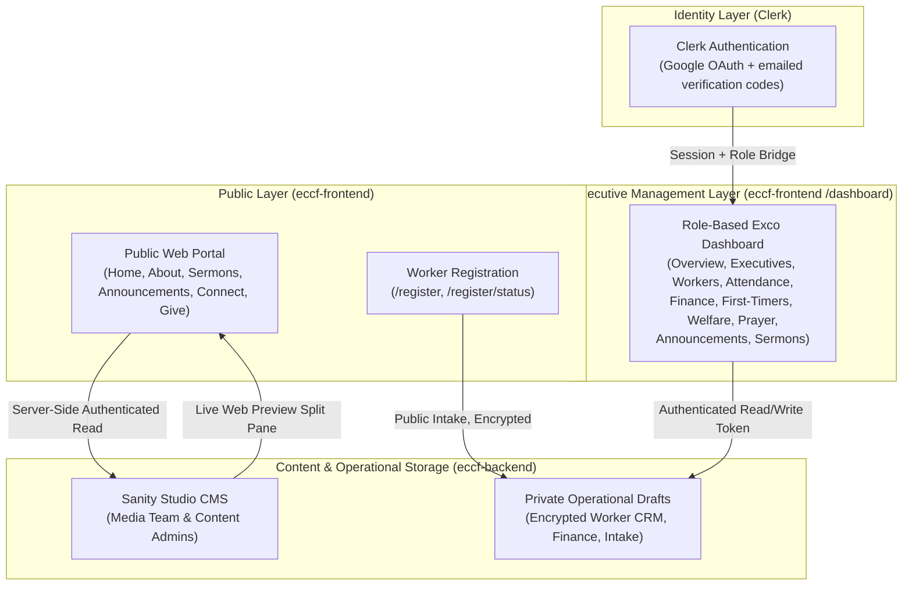

# ECCF Central Platform — Master Operational Manual
**Edo State University Christian Campus Fellowship (ECCF)**  
*Edo State University Iyamho (ESUI)*  
*Version 2.0 — Comprehensive Guide for Leaders, Workers, Media Stewards, and Fellowship Members*

**Last verified:** 26 October 2026 against frontend commit `d6fcf54` and backend commit `b4f94ba`.

> **Revision 2.0.** This edition replaces Version 1.0 and was checked line-by-line against the current frontend and Sanity schemas. Major corrections include: Clerk-only status tracking and sign-up, signed-in Clerk profile refresh, the 8-step worker intake with no executive application, multi-team memberships and position approvals, the CSGB executive console, manual announcement broadcasts, bank-transfer-only giving, role-scoped welfare contact visibility, dashboard-only PWA installation, the current six QA suites (61 tests), and the three-tab Connect hub. Where code and prose disagree, the code is the source of truth.

---

## Table of Contents
1. [Executive Summary & System Architecture](#1-executive-summary--system-architecture)
2. [Chapter 1: Fellowship Members & General Students (Public Website & PWA)](#chapter-1-fellowship-members--general-students-public-website--pwa)
3. [Chapter 2: Fellowship Workers & Volunteer Onboarding](#chapter-2-fellowship-workers--volunteer-onboarding)
4. [Chapter 3: President & Christian Student Governing Board (CSGB)](#chapter-3-president--christian-student-governing-board-csgb)
5. [Chapter 4: Media Team & Content Stewards (Sanity Studio & Sermons)](#chapter-4-media-team--content-stewards-sanity-studio--sermons)
6. [Chapter 5: Team Leaders & Assistant Leads (14 Ministry Teams)](#chapter-5-team-leaders--assistant-leads-14-ministry-teams)
7. [Chapter 6: Hall Representatives (Hostel / Campus Residence Pastors)](#chapter-6-hall-representatives-hostel--campus-residence-pastors)
8. [Chapter 7: Financial Secretary & Finance Team](#chapter-7-financial-secretary--finance-team)
9. [Chapter 8: Outreach, Evangelism & Follow-up Team](#chapter-8-outreach-evangelism--follow-up-team)
10. [Chapter 9: Intercessory Prayer Team](#chapter-9-intercessory-prayer-team)
11. [Chapter 10: Welfare & Medical Team](#chapter-10-welfare--medical-team)
12. [Chapter 11: Ushering Team (Headcount & Statistics)](#chapter-11-ushering-team-headcount--statistics)
13. [Chapter 12: Technical Administrators & Platform Engineers](#chapter-12-technical-administrators--platform-engineers)
14. [Appendix A: Role-Based Access Control (RBAC) Matrix](#appendix-a-role-based-access-control-rbac-matrix)
15. [Appendix B: Route & URL Directory](#appendix-b-route--url-directory)
16. [Appendix C: Operational Troubleshooting & FAQ](#appendix-c-operational-troubleshooting--faq)

---

## 1. Executive Summary & System Architecture

The ECCF Central Platform is a unified digital ecosystem designed to support the spiritual and academic mission of the **Edo State University Christian Campus Fellowship (ECCF)**: *"Jesus in our hearts, letters in our heads."*

The ecosystem consists of four interconnected layers:



### Core Security & Privacy Safeguards
1. **Private Dataset & Drafts Boundary:** The Sanity production dataset is set to access mode **private**, so an unauthenticated query returns nothing at all — not even published content such as sermons, announcements, gallery items, or leadership profiles. Every read is a server-side request authenticated with `SANITY_READ_TOKEN` (`lib/sanity.ts`, `useCdn: false` — there is no public CDN). A second, code-level boundary still applies: public pages query with the **published** perspective only, while sensitive records (worker profiles, financial entries, attendance rosters, first-timer contacts, welfare requests, prayer requests) are held as unpublished drafts that only the dashboard's drafts-perspective client can read.
2. **Field-Level AES-256-GCM Encryption:** Phone numbers and hostel room numbers are encrypted before they reach Sanity. Legacy keys are supported only for controlled re-encryption, via `ENCRYPTION_LEGACY_KEYS` and `HMAC_LEGACY_PEPPERS`.
3. **One-Way HMAC-SHA256 Blind Indexing:** Phone lookups and deduplication use a blind index, so searchable plain-text contact numbers are never stored.
4. **Clerk Identity + Strict RBAC:** Dashboard routes and server actions verify the Clerk session, resolve the worker record, and derive permissions from approved positions. Unauthorised sections are removed from navigation and blocked on direct URL access.
5. **Abuse & Consent Controls:** Public intake and subscription forms use Cloudflare Turnstile. Worker registration requires an explicit NDPR consent checkbox before submission.

> [!NOTE]
> The authoritative access rules live in `lib/dashboard/rbac.ts` and `lib/dashboard/access.ts`; the API/schema boundary lives in `lib/sanity.ts` and the `eccf-backend` schemas. This manual describes the behaviour of those files. If a future code change alters them, update this document in the same pull request.

---

## Chapter 1: Fellowship Members & General Students (Public Website & PWA)

Every student, alumnus, and campus visitor interacts with the public website at `https://eccf-frontend.vercel.app` (or the custom domain).

### 1.1 Homepage (`/`)
The homepage is server-rendered from live Sanity content and currently renders these sections, in order:

1. **Hero:** Fellowship headline, mission creed, introductory paragraph, a configurable top pill (default: *"Join us this week"*), and a five-photo **Formula 4 collage**. The collage is editable in Sanity; if fewer than five photos are configured, the built-in reference collage is used.
2. **Who We Are:** Chapter kicker ("Who We Are"), master declaration ("Raised for Kingdom Impact & Academic Distinction"), manifesto statement, the fellowship's **Three Core Pillars** (Romans 12:11: Diligence, Fervency, Christ-Centred Service) loaded live from Sanity `aboutPage.pillar*` with one-liner summaries, a direct link ("Explore Our Pillars & Mandate" with horizontal arrow), and clean layered photography (minister portrait and inset fellowship gathering photo, with no overlay badges or caption clutter).
3. **Weekly Service Schedule:** Day, time, title, badge, description, tags, and venue for each gathering.
4. **Latest Sermons:** Recent messages with links to the Sermon Vault and streaming platforms.
5. **Fellowship Moments:** Featured photo gallery.
6. **Giving Hub:** Verified bank-transfer details with a copy-account-number control.
7. **Social Media Banner:** Links to the fellowship's official channels.
8. **Plan a Visit:** Visit contact, WhatsApp link, and location guidance.

> [!IMPORTANT]
> The homepage no longer displays a **Next Service status pill** or a **Latest Announcements ticker**. Announcements live on `/announcements`, and the hero's visible pill is driven by the `heroTopPill` field. The legacy `liveStatusText` field still exists in the schema/query but is not rendered by the current frontend.

The global public chrome adds:
- **Navbar links:** Sermons, Giving (`/#giving`), About, Announcements, Connect.
- **The Launcher:** a floating bottom-right "next steps" card with an inline Connect Card plus configurable quick links. Default actions include Join A Team / Registrations (worker intake), Weekly Podcasts & Messages (`/sermons`), and Give Online (`/give`). The quick links are editable in Sanity under **Launcher Quick Links**.
- **Footer:** newsletter prompt, brand text, mission statement, meeting venue, active ministry, navigation columns, copyright, legal links (**Privacy & Data Care** and **Terms of Use**), and social links.

### 1.2 About Page (`/about`)
- **Mission & Vision:** The fellowship's spiritual mandate for Edo State University.
- **Our Story & Heritage:** Narrative, pull quote, and photo collage tracing ECCF's history.
- **Chronological Milestones:** Timeline entries with year, badge, title, and description.
- **Pillars of Faith:** Configurable pillars, each with a title, subtitle, scripture, description, and bullet points.
- **Leadership Gallery:** Five tiers — **Patrons**, **CSGB**, **Hall Pastors (Halls 1–8)**, **Team Leaders**, and **Assistant Team Leaders**. The roster is driven by Sanity `publicLeader` records. Patrons use the `patron` Leadership Category; the curated Patron list remains only as a fallback when no Patron records exist.
- **Operational Teams Directory:** Live `teamUnit` records describing the ministry teams. The same records drive every team picker across registration, attendance, the worker directory, and email audiences.
- **Section Visibility:** Every major section (Hero, Fellowship History & Milestones, Pillars, Leadership Gallery, Operational Teams, and Call-to-Action) can be hidden or shown via Studio toggles. When a section is unticked in Sanity, it disappears cleanly from the public site without deleting the underlying text, photos, or timeline.

> [!NOTE]
> There is no separate "resident pastor" tier. Hall Pastor cards deliberately omit personal hall/room labels so student residence information is not exposed publicly.

### 1.3 Sermon Vault (`/sermons`)
- **Multi-Platform Player:** Watch on YouTube or listen on Spotify / YouTube Music. Each message card exposes only the platforms that have been configured.
- **Search & Filters:** Search by **title, preacher, or series**; filter by topic tags derived from the live sermon catalogue.
- **No Public Download Button:** The site links out to the streaming platforms. It does not host an MP3 download control or a public sermon-notes reader.
- **Automatic Enrichment:** Visiting the homepage or Sermon Vault triggers a throttled background sync at most once every 15 minutes. The sync ingests the Spotify and YouTube RSS feeds and can enrich sermons with YouTube Data API v3 metadata when `YOUTUBE_API_KEY` is configured.

### 1.4 Sunday Announcements Hub (`/announcements`)
- **Category Filters:**
  - `WEEKLY SERVICES`
  - `ACADEMIC & EXAMS`
  - `BIBLE STUDY`
  - `EXCO UPDATES`
  - `GENERAL` (displayed as *General Fellowship*)
- **Pinned Notices:** Pinned bulletins sort to the top of the feed.
- **Search:** Free-text search across titles and bulletin content.
- **Subscribe to Broadcasts:** The subscription card collects an optional name and a required email address, protected by Turnstile. Subscribers receive manual broadcasts sent from the dashboard; subscribing does not automatically publish anything.
- **Automated Welcome Email:** Upon completing subscription, an automated welcome email is dispatched to the subscriber's inbox via Resend (`Welcome to Fellowship Updates!`) detailing the weekly service schedule, timings, and campus venue (NLT 5, Faculty of Law, ESUI).
- **Domain Verification Requirement:** Transactional delivery requires `RESEND_FROM_EMAIL` (or `EMAIL_FROM`) to be configured with an address on an active, verified custom domain (e.g., `contact@eccffamily.org` on `eccffamily.org` with DKIM and SPF configured). The development default `onboarding@resend.dev` will fail with a 403 `validation_error` when delivering to regular student or visitor email addresses.
- **Preview Mode:** `/announcements/preview` is an internal preview surface. It is not part of the public navigation.

### 1.5 Connect Hub (`/connect`)
The Connect Hub has exactly **three** tabs:

1. **First Timer ("New Here?"):** First name, last name, phone number, hostel/hall, room number, department, and level. The visit date is recorded automatically as the submission date; the form does not ask for a separate date.
2. **Welfare ("Need Support?"):** Name, phone number, and a confidential description of the need.
3. **Prayer ("Need Prayer?"):** An optional name and the prayer request. Leaving the name blank submits the request anonymously.

> [!IMPORTANT]
> There is no **"Join a Team"** tab in the Connect Hub. Prospective workers use the Launcher's **Join A Team / Registrations** actions or go directly to `/register`.

### 1.6 Online Giving & Stewardship (`/give`)
- **Bank Transfer Only:** The page displays the fellowship's verified bank name, account name, and a 10-digit account number, plus any instructions configured in Sanity. The account number can be copied with one tap.
- **No Flutterwave Checkout:** There is no card, USSD, or automated online checkout, no payment webhook, and no automatic receipt generation. Contributions are reconciled manually by the Finance team.
- **Financial Integrity:** The page explains that funds are stewarded under the CSGB and Financial Secretary. Published account details are managed in **Site Settings → Giving Accounts**.

### 1.7 Installing the Progressive Web App (PWA)
The PWA is intentionally an **Exco dashboard application**, not a public-site app.

- **Manifest:** Served from `/manifest.webmanifest`; the app name is **"ECCF Exco Dashboard"**, and `start_url` and `scope` are `/dashboard`.
- **Install Control:** Authenticated leaders use the **Install App** button in the dashboard top bar. It captures the browser's native install prompt on Chrome, Edge, and Android, and shows iOS Safari instructions (Share -> Add to Home Screen) when needed.
- **Already Installed:** The button hides automatically when the app is running in standalone mode.
- **Public Site:** Install prompts are suppressed on public pages. Visitors browsing the marketing site will not be prompted to install the portal.
- **No Offline Data Cache:** The project does not register a service worker. The installed app opens in a standalone window but still requires network access and a valid Clerk session for dashboard data.

### 1.8 Page Maintenance Mode
Any public route (`/`, `/about`, `/sermons`, `/announcements`, `/connect`, `/give`, `/register`, `/privacy`, `/terms`) can be placed under maintenance directly from Sanity Studio (**Homepage & Site Settings → Maintenance Mode**).

- **Visitor Experience:** When a page is under maintenance, visitors see a dedicated chrome-free full-screen banner (`PageMaintenance`) with the ECCF crest, the configured maintenance headline (default: *"We will be right back."*), explanation message, and optional timeframe badge (`maintenanceEta`).
- **Path Nesting:** Ticking a parent path covers all nested sub-routes (e.g. ticking `/sermons` closes `/sermons` and all nested sermon routes; ticking `/` closes only the root homepage).
- **Editor Bypass:** Authenticated editors viewing the site through Sanity Studio Live Web Preview (`?preview=true`) or Next.js Draft Mode bypass maintenance automatically, allowing media stewards to edit and review closed pages live.

---

## Chapter 2: Fellowship Workers & Volunteer Onboarding

### 2.1 Registering as a Worker (`/register`)
Any student desiring to serve in ECCF registers through the official worker intake portal. The form supports **new workers**, **signed-in workers refreshing a linked profile**, and **returning workers updating an existing profile**.

#### Signed-In Profile Refresh (Preferred)
If you are signed in with Clerk and your account is already trusted for a worker record, `/register` opens at **Profile Refresh**, step 2 of 4. Trust is established when the worker record is linked to your Clerk user ID or when Clerk has verified the same email and the record is not linked to a different sign-in method. Clerk's verified session replaces the email code, so no second OTP is required.

You can update names, birthday month/day, hall/room, operational teams, and the optional photo. Email and phone stay read-only; contact-detail changes require an administrator. The page shows **"Profile linked"** and a **My status** link.

If the email matches a worker record linked to a different sign-in method, the page shows **"One more check"** and requires the email code. If no worker profile is linked yet, the page starts a new registration and links the new record to the signed-in Clerk account on save.

#### New Worker Flow (8 Steps)
1. **Phone Gateway:** Enter a phone number. Signed-out visitors then complete the **Turnstile** bot check — the widget appears as soon as 8+ digits are typed. The check is presented **once** for the whole form: passing it is remembered through every later step (email confirmation, review, and submission), and Clerk-signed-in users bypass it entirely. The action rejects requests without a valid challenge, then checks whether the number already belongs to a worker.
2. **Name:** First name, middle name (optional), and last name.
3. **Email Confirmation:** Enter a valid personal email address and select **"Send Confirmation Code."** A 6-digit code is emailed to the address (it expires in 10 minutes; the resend cooldown is 60 seconds and allows up to 5 attempts). Enter the code and select **"Confirm Email & Continue."** The next steps stay locked until the code proves the applicant can read the inbox. The confirmed address becomes the identity used for Clerk sign-in and status access. Editing the address after confirmation voids the proof and repeats this step.
4. **Operational Teams:** Select one or more published fellowship teams. The list is read live from **Teams & Units** in Sanity. Multi-team membership is supported and expected.
5. **Residence:** Pick a hall of residence from the **Halls of Residence** table in Sanity (falls back to Halls 1–8 when the Studio is unreachable) and enter a room number. Every intake form and dashboard hall filter reads the same list, so renaming a hall updates everything. Room data is encrypted before storage.
6. **Birthday:** Select the birthday **month and day**. The year is not collected.
7. **Birthday Photo (Required):** Upload a celebratory photo, maximum 5 MB. The image is compressed before upload; the server rejects stored assets larger than 2 MB, and registration cannot be completed without it. The same picture becomes your Exco profile photo in the dashboard, and you can replace it any time later from the portal.
8. **Review & Consent:** Review name, email, phone, selected teams, hostel/room, and birthday. Check the **NDPR consent** box and select **"Complete Registration"** (no second security check is required — it was passed once at step 1).

> [!NOTE]
> The intake form does **not** collect academic department, academic level, password, or an executive application. Executive positions are appointed separately and approved by the President.

> [!NOTE]
> Draft persistence: in-progress entries for **signed-out new-worker registrations** are auto-saved to the browser tab's session storage (`eccf_worker_reg_draft_v1`) — the current step, names, phone, email and its confirmation state, selected teams, hall/room, and birthday. Reopening `/register` in the same browser tab restores the draft where it left off. An in-flight email-OTP challenge also survives a full page reload, so the verification screen appears immediately instead of restarting at the phone step. The draft does not carry to other tabs or survive a closed tab, and it is wiped as soon as registration completes successfully. Signed-in profile refreshes and self-service-token sessions do not use the draft store.

#### Returning Worker Flow (4 Steps)
**Signed-in trusted workers** use the Profile Refresh path above and start at step 2.

**Signed-out workers** can either enter the phone number on file at step 1, or select **"Already registered as a worker?"** and enter the registered email or phone number; recovery reuses the flow's one-time security check instead of a second widget. The system sends a **6-digit verification code and a secure unlock link** to the email on file. Both expire after **15 minutes** (the resend cooldown is 60 seconds).

1. Verify ownership with the phone number, or with the registered email/phone recovery form, and the emailed code/link.
2. Review and update your profile: first/middle/last name, birthday month and day, hall and room, and operational team memberships. The email and phone on file are shown read-only.
3. Replace the optional birthday photo.
4. Confirm the profile and select **"Save Profile Updates"** (no second security check — the step-1 check covers the whole flow).

#### What Happens After Submission
- The worker profile is stored as a private operational draft.
- For a new profile, each selected team membership starts as **Pending** and is routed to that team's leader for verification. On a refresh, existing memberships keep their current status; newly selected teams start **Pending**.
- When a team lead verifies a membership, the worker receives the official **"Welcome to the ECCF Workforce Platform"** email. It is sent once and tracked on the worker profile, so re-verifications do not re-send it.
- New registrations show **"Registration Confirmed"**; profile refreshes show **"Profile Updated"**. Both screens list the selected teams, hall/room, and the note *"Review by Team Leads"*.
- Executive appointments are **not** requested here. When CSGB leadership records an appointed position in `/dashboard/executives`, the related operational team membership is verified automatically, and executive sign-in access is activated immediately.

### 2.2 Tracking Your Registration Status (`/register/status`)
The status tracker is now **privacy-protected by Clerk**. There is no phone-number + OTP lookup on this page.

1. Navigate to `/register/status`.
2. If you are not signed in, the page shows **"Authentication Required"** and links to `/login`. The page explains that sign-in is required to protect member privacy and hostel room information.
3. Sign in with the verified email or Google account associated with your worker profile.
4. Review:
   - **Team Memberships:** Each team and its status — `Pending`, `Verified`, or `Declined`.
   - **Executive Positions:** Each position and its status — `Pending`, `Approved`, or `Declined`.
   - **Profile Details:** Name, contact details, hall/room, and birthday information on file.
   - **Clerk Link Status:** Whether the worker profile is linked to a Clerk identity.

> [!NOTE]
> If no executive positions exist, the status page explains that executive positions are appointed by the Fellowship President and directs the worker to the President or Technical Administrator. It no longer links to `/register` as an application path.

### 2.3 Worker & Leader Sign-In (`/login` and `/sign-up`)
1. Navigate to `/login`.
2. Sign in through Clerk using **Google OAuth** or an **emailed verification code**. Passwords are not used.
3. First-time Exco members who do not yet have a Clerk account use `/sign-up`.
4. **Previously registered but cannot sign in?** Use the **"Activate Login"** form below the Clerk card. Enter the email address on your worker profile. The system finds the worker, creates or links the Clerk user, stores `clerkUserId` on the profile, and asks you to sign in with that same email.
5. After authentication you land on `/dashboard`. Only workers with an approved executive, team-lead, hall, or team-membership position resolve a dashboard session; anyone without one is returned to `/login` with an **approval pending** notice instead of an empty dashboard.

Routing notes:
- The dashboard middleware protects `/dashboard(.*)`.
- `/dashboard/login` permanently redirects to `/login`.
- `/dashboard/sign-up` permanently redirects to `/sign-up`.
- `DASHBOARD_MOCK_AUTH=1` enables a local-only mock session outside production; it never applies in production.

> [!NOTE]
> Approved executives can sign in straight with Google when the Google account's verified email matches the email on their worker profile — the session bridge links them automatically. Legacy accounts that never signed in with Clerk still use the **"Activate Login"** form below the Clerk card.

---

## Chapter 3: President & Christian Student Governing Board (CSGB)

The President and CSGB executives hold central oversight over fellowship operations, student governance, and executive appointments. Access is derived from **approved positions**, not from job titles typed into a form.

### 3.1 Overview Dashboard (`/dashboard`)
The overview opens as a calm, attention-first **Executive Cockpit**: a date-only eyebrow (full weekday, day, month, year), then one greeting heading — **"Good morning, {firstName}"** finished in quiet muted text by the leader's **official appointed post** (for example " — President" or " — Hall Pastor (Hall 1)"; admins without a specific office show "CSGB Executive"). The greeting is the page title; serving teams appear in the profile menu and workforce directory, not in the heading. The heading is accompanied by a single **Record attendance** header action for every role with attendance access.

**"Do this now" Attention Queue** (first content block, streamed live from Sanity — no mock data):
- A **role-scoped urgency queue** of the items that need someone today:
  - **Pending worker verifications** — the names/count of workers still awaiting verification on your roster (urgent for verifying leaders; advisory for the President).
  - **Executive onboarding** — leadership appointments awaiting action (President/CSGB view).
  - **Active welfare cases** — pending student-support requests awaiting pastoral follow-up.
  - **First-timers needing contact** — visitors not yet marked as followed up.
- Items sort strictly by urgency, each linking into its section (e.g. **Verify N pending workers → Review approvals**). When nothing is open, the queue collapses to a quiet **"You're all caught up"** state.

**Aligned pulse strip** (cards appear only for sections you can open) — two cards per row on phones and tablets, up to five across on desktop:
- First-timers this month (month-to-date caption; prefixed "In your hall" for Hall Pastors)
- Pending welfare requests (caption "Needs follow-up" / "All caught up")
- Prayer requests (last 7 days)
- Workers (scoped caption: "In your hall" for Hall Pastors, "In {team}" for regular Team Leaders, otherwise "Across all halls")
- **Last meeting attendance** for regular Team Leaders (meeting title + relative day; empty state "No meetings recorded yet") or **Last service attendance** for everyone else (service type + relative day; "No services recorded yet")
- Finance statistics (admins and finance role), three cards on desktop: Income / Expenses / Net this month, each captioned "Since 1 {month}", with Surplus / Deficit / Break-even on the Net card (full-width row on phones and tablets)

**Activity lists (two columns on large screens):** **Recent First-Timers** and **Recent Welfare Requests**, shown only to roles that can access those sections.

> [!IMPORTANT]
> The overview no longer contains an attendance trends chart, a quick-actions grid, or a workforce mail shortcut. All workforce email lives in the **Workforce Directory** (`/dashboard/workers`, the *Send Email to Workers* card). The last-attendance card is the current at-a-glance attendance indicator.

### 3.2 Executive Council & Leadership Roster Console (`/dashboard/executives`)
> [!IMPORTANT]
> Access is no longer President-only. The console opens for **CSGB executives** — President, Vice Presidents, General Secretary, and Prayer Coordinator (the `admin` role) — plus the **Fellowship Chaplain**. All others are redirected to the overview with an access-denied toast.

#### Reading the leadership roster
1. Open `/dashboard/executives`. The heading reads **Executive Council & Leadership Roster**, with four counters: **Total Leaders**, **CSGB Board**, **Hall Pastors**, and **Team Leads**.
2. Search by name, hall, office, or team.
3. Filter with the tab rail: **All**, **CSGB**, **Hall**, **Team**.
4. Review each card: avatar/initials, name, mapped office, hall or team, rank, and appointment date.

#### Managing appointments (President, Vice President, Chaplain, or admin role)
- **Import Leadership Roster** — a bulk appointment pipeline from CSV/XLSX:
  1. Upload the spreadsheet and choose options, including **auto-creating missing worker profiles**.
  2. Review the interactive **mapping & preview** table before anything saves: matched registered workers vs. new profiles to create, mapped CSGB offices (from the dynamic Sanity `csgbRole` list), halls, and ministry teams; toggle **Lead vs Assistant** rank or deselect specific rows.
  3. Confirm the import. **Smart name matching** ties spreadsheet rows to existing workers, and unmatched leaders get created as worker profiles automatically.
- After a managed import the affected executives are **activated immediately** — their dashboard sessions profile photo, post label, and permissions update on their next sign-in.
- Re-running an import **updates existing appointments instead of duplicating them** (positional smart-merge). The mapping additionally resolves raw spreadsheet text — including synonyms like "VP 1", "Gen. Sec", or protocol→Ushering — to exact Sanity `csgbRole`, `hallResidence`, and `teamUnit` documents, and rank (Lead / Assistant) is set per row in the preview. There is no in-console relieve control; removing a superseded appointment happens in Sanity Studio. Deep authorisations (approvers) come from the `canApproveExecutives` flag on the CSGB Role document.

> [!NOTE]
> CSGB offices are dynamic: they are **`csgbRole` documents in Sanity** (baseline: President & Executive Shepherd, VP Admin/Brothers' Coordinator, VP Evangelism/Sisters' Coordinator, General Secretary, Prayer Coordinator). Adding, renaming, or reordering an office in the Studio updates selection dropdowns, dashboard labels, and access decisions everywhere.

> [!NOTE]
> There is no intake-form executive application. Appointments are bulk-imported or handled in the console on this page; `/register/status` directs workers to the President or Technical Administrator when a position is missing.

### 3.3 Sunday Announcements Engine (`/dashboard/announcements`)
Access is limited to **CSGB members**: admins, the President, Vice Presidents, the General Secretary, and Prayer leadership (including a Prayer Team Lead). Ordinary team leads cannot open this section unless their position also satisfies the CSGB test.

#### Creating a New Announcement:
1. Select **"New Announcement"**.
2. Optionally start from a **template chip**: Sunday Service, Wednesday Study, Night Vigil, or Exams Clinic. Templates prefill the category and body.
3. Complete the fields:
   - **Title** (minimum 3 characters)
   - **Category** — `WEEKLY SERVICES`, `ACADEMIC & EXAMS`, `BIBLE STUDY`, `EXCO UPDATES`, or `GENERAL`
   - **Event Date** and **Publish Date**
   - **Time** and **Location** (defaults to the fellowship venue if left blank)
   - **Content** — rich text with bold, lists, links, and scripture quotes
   - **Pin Announcement** — keeps the notice at the top of the public feed
   - **Published** — makes it live on `/announcements`
4. Select **"Save Announcement"**.

#### Broadcasting to Subscribers:
There is **no "Send Broadcast on Publish" toggle** in the current modal. Publishing and emailing are separate actions. New announcements are stored with automatic broadcast explicitly disabled; existing announcement documents are left untouched.

1. Publish the announcement first; the **Broadcast** action is disabled for drafts.
2. On the announcement card, select **"Broadcast"**. A confirmation dialog opens.
3. Confirm to send the email to all active subscribers through Resend.
4. The card changes to **"Broadcast sent"** and the action becomes **"Re-send"** for a deliberate repeat send.
5. If there are no active subscribers, the action reports that the mailing list is empty.

The dashboard summary counters show total announcements, published notices, drafts, pinned notices, and broadcasted notices.

### 3.4 Pastoral & Workforce Oversight
- **Workforce Directory (`/dashboard/workers`):** Fellowship-wide roster for admins; team-scoped for regular team leads; hall-scoped for hall reps; fellowship-wide read-only directory for Media leads. Compact rows open a **profile drawer** used for verification, executive approval, and a replacement profile photo. Includes the workforce email card and pending-approval banners.
- **Prayer Feed (`/dashboard/prayer-requests`):** Confidential petitions submitted through `/connect`; open to the CSGB, the Chaplain, and prayer leadership only.
- **Welfare Hub (`/dashboard/welfare`):** the **Welfare Purse Ledger** plus the care-request queue; open to the Welfare & Medical team, the CSGB, and the Chaplain only.
- **First-Timers (`/dashboard/first-timers`):** Campus-wide for admins and outreach leads; hall-scoped for hall reps; follow-up status is now tracked with leader attribution.
- **Settings & Admin Tools (`/dashboard/settings`):** privileged roster import, worker offboarding, and directory-sync pipeline for the President and CSGB Admins.

---

## Chapter 4: Media Team & Content Stewards (Sanity Studio & Sermons)

> [!NOTE]
> The **Media Team** is the custodian of the public website's text, images, banners, and digital assets via **Sanity Studio** (`https://eccf-backend.sanity.studio`).

### 4.1 Accessing Sanity Studio
1. Open `https://eccf-backend.sanity.studio`.
2. Sign in with an authorised Sanity account (Google or GitHub authentication).
3. The Studio Desk provides the content schema list on the left and the document editor on the right.
4. Content types with public representations expose a **"Live Web Preview"** tab beside the edit form: announcements, sermons, the About page, Site Settings, service schedules, gallery items, team units, and public leaders.

### 4.2 Updating Homepage & Site Settings (`siteSettings`)
1. In the Studio sidebar, open **"Homepage & Site Settings"**.
2. Edit the singleton document using the group tabs:
   - **Homepage Hero:**
     - `Hero Headline`, `Fellowship Credo / Motto`, and `Hero Mission Paragraph`.
     - `Hero Top Pill` — the visible pill above the headline (default *"Join us this week"*).
     - `Hero 5-Photo Collage` — upload/replace the five collage images and set their alt text and tag. If fewer than five are configured, the reference collage is displayed.
     - `Who We Are: Minister / Pastor / President Photo (Left)` (`whoWeArePhotoMinister`) — portrait photograph of the Pastor or President displayed on the left of the Who We Are section.
     - `Who We Are: Congregation / Audience Photo (Right)` (`whoWeArePhotoAudience`) — photograph of students or congregation displayed as the inset photo on the right.
     - If left unassigned in Site Settings, the Who We Are section automatically falls back to curated high-resolution images from the published Photo Gallery.
     - `Hero Photo` — legacy single-photo field retained for compatibility.
     - `Live Status Text` — retained in the schema but not rendered by the current frontend.
   - **Metrics & Legacy:** `Active Members`, `Weekly Services`, and `Campus Legacy` statistics displayed in the Who We Are section.
   - **Plan a Visit:** Visit contact person, WhatsApp number, and visit photo.
   - **Giving Accounts:** Bank name, account name, 10-digit account number, and transfer instructions.
   - **Website Footer:** Newsletter heading and description, brand title/subtitle, mission statement, logo, meeting venue, active ministry, copyright, and footer navigation columns.
   - **Social Channels:** Fellowship email, YouTube, Instagram, Facebook, TikTok, Telegram, X/Twitter, and WhatsApp URLs.
   - **Maintenance Mode:**
     - `Put Pages Under Maintenance` (`maintenancePages`) — checklist of public routes (`/`, `/about`, `/sermons`, `/announcements`, `/connect`, `/give`, `/register`, `/privacy`, `/terms`). Ticking any route displays a dedicated full-screen maintenance notice to visitors instead of the normal page content and navigation. Sanity live web preview and draft mode bypass maintenance automatically so editors can work on closed pages without interruption.
     - `Maintenance Headline` (`maintenanceHeadline`) — primary heading on paused pages (default: *"We will be right back."*).
     - `Maintenance Message` (`maintenanceMessage`) — visitor guidance text beneath the headline.
     - `Expected Back` (`maintenanceEta`) — optional timeframe badge (e.g. *"Back before Sunday service"*). Leave blank to omit.
   - **Launcher Quick Links:** Title, subtitle, target URL/anchor, icon type (podcast, visit, give, announcement, portal), and external-link flag for the floating launcher.
3. Select **"Publish"**. The public site is server-rendered with `force-dynamic`, so published changes appear on the next request.

### 4.3 Updating the About Page (`aboutPage`)
1. Open **"About Page"**.
2. Edit:
   - **Hero:** badge, location subheading, master headline, subtitle, mission creed, and hero photo.
   - **Metrics:** operational teams, residence halls, weekly encounters, and student impact.
   - **Story:** headline, lead, narrative paragraphs, pull quote, and two story photos.
   - **Milestones:** year/period, badge, title, and description.
   - **Core Pillars:** headline, lead, and pillar entries (title, subtitle, scripture, description, bullet points).
   - **Leadership:** section headline and subtitle.
   - **Teams:** section headline and subtitle.
   - **CTA:** tag, headline, and subtitle.
   - **Section Visibility:** Checkbox controls under the "Section Visibility" fieldset:
     - `Show Hero & Mission Manifesto` (`showHero`)
     - `Show Fellowship History & Milestones` (`showHistory`) — untick this while the history narrative and timeline are still being drafted. The section disappears cleanly from the public page while preserving all text, photos, and milestones saved in Sanity.
     - `Show Core Pillars (Romans 12:11)` (`showPillars`)
     - `Show Leadership Gallery (CSGB & Directors)` (`showLeadership`)
     - `Show Operational Teams` (`showTeams`)
     - `Show Bottom Call-To-Action Banner` (`showCta`)

> [!NOTE]
> The Three Core Pillars configured in `aboutPage` (Romans 12:11: Diligence, Fervency, Christ-Centred Service) drive both the full detailed pillar cards on `/about#pillars` and the one-liner summary ledger in the homepage's **Who We Are** section (`/`). Updating pillar titles and subtitles here keeps both pages synchronized.
3. Select **"Publish"**.

### 4.4 Managing the Photo Gallery (`galleryItem`)
1. Open **"Photo Gallery"** and select **"Create New"**.
2. Complete:
   - **Photo Title**
   - **Category** — `Sunday Service`, `Bible Study`, `Student Life`, `Prayer Night`, `Excellence`, `Outreach`, or `Exco Roster`
   - **Photo Image** — upload a high-resolution image and set the hotspot/focal point
   - **Caption / Short Description**
   - **Featured on Homepage** — the homepage visibility switch. Ticked = shown on the public homepage; unticked = hidden from the site but kept safely in the Studio
   - **Display Order** — optional. `1` appears first, `2` second, and so on. Leave blank to place the photo after all numbered photos, newest first
3. Select **"Publish"**.

> [!NOTE]
> The homepage gallery only shows photos with **Featured on Homepage** ticked (8 at a time, with a "View All" button for the rest). Unticking the box hides a photo from the public site without deleting it or its uploaded image. **Display Order** controls the sequence; blank or duplicate numbers fall back to newest upload first.

> [!NOTE]
> The gallery schema no longer has a separate "Event Date" field. Use the caption or title if a date needs to be shown.

### 4.5 Managing Weekly Service Schedules (`serviceSchedule`)
1. Open **"Weekly Fellowship Schedule"**.
2. Add or edit each gathering:
   - **Day of the Week**, **Service Time**, **Service Title**, **Badge / Category Tag**
   - **Service Description**, **Highlight Tags / Focus Points**, **Venue Location**
   - **Display Order**
3. Select **"Publish"**. The homepage renders the schedule in display order.

### 4.6 Managing Public Executive Profiles (`publicLeader`)
1. Open **"Public Leaders"**.
2. Add or update:
   - **Full Name**
   - **Official Position** (e.g., President, General Secretary)
   - **Official Portrait Photo** (hotspot supported)
   - **Leadership Category** — optional: `Patron`, `CSGB Executive`, `Hall Pastor`, `Team Leader`, or `Assistant Team Leader`
   - **Display Order**
3. Select **"Publish"**.

> [!NOTE]
> Patrons are a selectable `publicLeader` category. Add a record with **Leadership Category: Patron** to publish a Patron card. The About page only falls back to its curated Patrons list when no Sanity record is tagged as a patron. Use the supported categories for all current leaders.

### 4.7 Managing Operational Team Profiles (`teamUnit`)
1. Open **"Teams & Units"**.
2. Maintain each team's **name**, **system key slug**, **team photo**, **short description**, **display order**, and **Meeting Day / Meeting Time / Meeting Venue** (all optional).
3. Select **"Publish"**.

> [!NOTE]
> `teamUnit` is the single source of truth for team names. Once a team is **published**, it automatically appears in the registration picker, attendance team filters/rosters, the worker directory filter, the hall dropdown on intake forms, and worker email audiences — no code change or redeploy is needed. The static list in `lib/dashboard/attendance-constants.ts` is an offline fallback used only when Sanity cannot be reached.
>
> The meeting logistics fields are optional: when filled, the About page's Operational Teams cards show the day/time/venue chip; when left blank the chip is hidden. Weekly public services still live in the **Weekly Fellowship Schedule**.

### 4.8 Dashboard Sermon Management (`/dashboard/sermons`)
Access is restricted to **Media leaders**. The check accepts an approved position on a team whose key is `media`/`media-technical` or whose name contains "Media", or a legacy media appointment. The admin role alone does not grant this section, and a CSGB admin without a media position is blocked. Because the check is name-based, an approved position on the **Drama/Creative Media Team** also qualifies.

> [!NOTE]
> If the President needs to manage sermons, add an approved Media Team position for that account; the admin role alone will not open the section.

1. Open `/dashboard/sermons`.
2. Select **"New Sermon"**.
3. Complete:
   - **Sermon Title**
   - **Preacher**
   - **Date Preached**
   - **Primary Scripture Reference**
   - **Sermon Series** and **Topical Tags**
   - **Media URL** (direct audio, optional)
   - **Duration**
   - **Spotify Episode URL**
   - **YouTube Video URL**
   - **Notes**
4. Select **"Save Changes"**.

Platform behaviour:
- There is **no separate YouTube Music input** in the sermon form. When a YouTube video is present, the public card derives the YouTube Music link from the video ID.
- The public player shows Spotify and YouTube Music links only when the corresponding URLs exist.

#### Syncing External Feeds
- The toolbar button is **"Sync Feeds (RSS)"** (while running: *"Syncing Feeds..."*).
- The sync ingests the configured Spotify/Anchor RSS feed and YouTube playlist RSS feed.
- Known sermons are resolved from a curated catalogue first; unknown titles can be enriched through the **YouTube Data API v3** when `YOUTUBE_API_KEY` is set.
- The Sermon Vault and homepage also trigger the same sync at most once every 15 minutes in the background.
- Dashboard search covers title, preacher, scripture reference, series, and topics. Filters include topic and origin (`all`, `synced`, `manual`), with card and table views.

---

## Chapter 5: Team Leaders & Assistant Leads (14 Ministry Teams)

This chapter applies to the leaders of all 14 ECCF teams:
*Bible Study/Sunday School, Prayer, Protocol, Financial, Choir, Ushering, Drama/Creative Media, Outreach, Welfare/Medical, Academic, Colporteur/Library, Technical, Media, Decoration.*

### 5.1 Team Workforce Verification (`/dashboard/workers`)
When a student registers at `/register` and selects your team, the membership appears in your team roster with status **Pending**.

#### Verifying a Team Member:
1. Open `/dashboard/workers`.
2. The roster is scoped to the team(s) you lead. Media leads see the fellowship-wide directory for celebrations and media coverage.
3. Review the worker's name, contact details, hall, team(s), and status.
4. Meet the worker during rehearsals or meetings to confirm commitment.
5. Choose:
   - **Approve / Verify** — the membership becomes **Verified** and the worker sees the green verified badge on `/register/status`.
   - **Decline / Reject** — the membership becomes **Declined**.
6. Pending approvals are highlighted in the page banner and counted in the header.

> [!IMPORTANT]
> Verification is per team membership. A worker serving in multiple teams can be verified by each team independently. Assistant Team Leads with an approved assistant position receive the same scoped team access as the lead. Media leads see the fellowship-wide directory but cannot approve or decline memberships.

### 5.2 Logging Team Meeting Attendance (`/dashboard/attendance`)
1. Open `/dashboard/attendance`.
2. If your account has both consoles, select the **"Team Rosters"** tab; otherwise the team roster is the default view (labelled e.g. *"Choir Roster"*).
3. Select **"Take Meeting Attendance"**.
4. Complete:
   - **Meeting Title** (e.g., *Weekly Choir Rehearsal*)
   - **Date**
   - **Team** (fixed to your team for team leads; admins can choose)
5. Use the **Team Member Roster**:
   - Tick each worker who was present.
   - Use the select-all / clear controls for fast roster updates.
6. Add **Guest / Visiting Attendees** as a count.
7. Add **Meeting Notes / Agenda Summary** (e.g., *"Late arrival due to 400L lab practicals"*).
8. The form displays `workers + guests = total present`.
9. Select **"Save Attendance (n)"**.

Past meeting records can be reopened to review the saved roster.

### 5.3 Sending Team Emails
1. Open `/dashboard/workers`.
2. Use the **Send Email to Workers** card, or expand it into the full dialog.
3. Choose the recipient scope available to your role — your team (or an individual member of it) for team leads; all workers or any individual for admins.
4. Write the subject and message, then send through the configured Resend integration.

> [!NOTE]
> There is no separate "Send Team Email" page. The workflow lives inside the workforce directory and respects the same team scoping.

---

## Chapter 6: Hall Representatives (Hostel / Campus Residence Pastors)

Hall Reps serve as on-the-ground spiritual shepherds in the student hostels. Approved Hall positions are recorded as `kind: 'hall'` positions for Halls 1–8.

### 6.1 Scoped Hall Roster (`/dashboard/workers`)
- Hall Reps see workers residing in their assigned hall.
- The header identifies the hall (e.g., *"Hall 3 Workers Roster"*).
- Use the roster to identify students living near one another, encourage room fellowships, and coordinate morning devotions.
- Hall Reps cannot open the fellowship-wide directory or verify team memberships.

### 6.2 First-Timers Follow-Up (`/dashboard/first-timers`)
When a fresher or new student submits the Connect card or First Timer form and indicates your hall:
1. Open `/dashboard/first-timers`.
2. The console is scoped to your hall; the header and filter badge confirm the scope.
3. Review the visitor's name, phone number, hall/room, department, level, and visit date.
4. Use the follow-up actions:
   - **Copy phone number** for a call or SMS.
   - **WhatsApp** to open a pre-filled greeting that introduces you as the hall representative and invites the visitor to fellowship.
   - **View details** for the full record.
5. Coordinate with the Outreach team for campus-wide follow-up.

> [!NOTE]
> The current console does **not** provide a free-text follow-up notes field or an assignment workflow. Record keeping beyond the initial contact happens outside the dashboard (e.g., team records or a supervised follow-up log).

### 6.3 Attendance & Section Limits
- **Attendance (`/dashboard/attendance`):** Hall Reps can open the Attendance section and use the team-roster view. The **General Headcount** console is limited to admins and Ushering team members; Hall Reps cannot record general service headcounts unless they also hold an Ushering position.
- **Welfare is no longer open to Hall Pastors.** The Welfare Hub is restricted to the Welfare & Medical team, the CSGB, and the Chaplain.
- **Prayer petitions are no longer open to Hall Pastors.** The prayer feed is restricted to prayer leadership, the CSGB, and the Chaplain.

Hall Pastors remain the follow-up anchor for visitors in their hall — see §6.2 — and the hall-scoped first-timers console still guides that work.

---

## Chapter 7: Financial Secretary & Finance Team

The Financial Secretary and Finance team manage fellowship accounting with strict transparency and accountability. The ledger is stored as private operational drafts.

### 7.1 Financial Overview & KPI Cards (`/dashboard/finance`)
- **Total Inflow (Income):** Sum of all recorded income entries.
- **Total Outflow (Expense):** Sum of all recorded expense entries.
- **Net Balance:** Total Inflow minus Total Outflow.

The KPI cards recalculate immediately when a transaction is added. There is no semester selector; the figures reflect the records currently loaded in the ledger.

### 7.2 Recording Income Transactions
1. Open `/dashboard/finance`.
2. Select **"Record Transaction"**.
3. Complete:
   - **Type:** `Income`
   - **Category:** `Tithe`, `Offering`, `Project Levy`, `Online Giving`, or `Miscellaneous`
   - **Amount (NGN)**
   - **Date**
   - **Description** (e.g., *Sunday 2nd Service Tithes & Offerings*)
4. Select **"Save Transaction"**.

> [!IMPORTANT]
> The current modal has **no Flutterwave Reference input**. Online giving is a manual bank transfer, so the Finance team records the deposit and describes the narration in the Description field. Existing legacy records may still display a stored Flutterwave reference.

### 7.3 Recording Expense Disbursements
1. Select **"Record Transaction"**.
2. Complete:
   - **Type:** `Expense`
   - **Category:** `Welfare Disbursement`, `Utility Expense`, `Event Expense`, or `Miscellaneous`
   - **Amount (NGN)**
   - **Date**
   - **Description** (e.g., *Approved medical emergency support for a 200L student*)
3. Select **"Save Transaction"**.

### 7.4 Exporting Financial Ledgers for Audit
1. Apply the desired search and type filters. The export uses the **currently filtered rows**, not the entire ledger.
2. Select **"Export CSV"**.
3. The download is named `eccf_finance_ledger_YYYY-MM-DD.csv` and contains:
   - Transaction Date
   - Type
   - Amount (NGN)
   - Category
   - Description
   - Flutterwave Ref (legacy column; blank for new records)
4. Submit the file for monthly CSGB reviews and business meetings.

### 7.5 Controls & Confidentiality
- Finance records are private drafts, not published Sanity documents.
- The **finance** role can access the Finance section and finance statistics only. It cannot open first-timers, prayer requests, or welfare.
- The President (admin) can access both finance and pastoral sections.
- Manual reconciliation is required for every bank-transfer gift; the platform does not verify payments automatically.

---

## Chapter 8: Outreach, Evangelism & Follow-up Team

The Outreach & Evangelism team leads soul-winning initiatives on campus and ensures every visitor is embraced into the fellowship family.

### 8.1 First-Timers Intake Console (`/dashboard/first-timers`)
Access:
- **Admins:** all visitors across all halls.
- **Outreach Team Lead / Follow-up Lead:** all visitors campus-wide, with an *"Outreach Coordinator"* badge.
- **Hall Reps:** visitors in their assigned hall only.
- **Other roles:** no access.

The console shows:
- **Total first-timers** (or *"First-Timers in Hall"* for Hall Reps)
- **Ready for WhatsApp** — visitors with a usable phone number
- **Hostel coverage** — number of halls represented, or the assigned hall

Table columns:
- **Visitor** — full name and phone number (with copy control)
- **Campus Residence** — hall and room
- **Department & Level**
- **Date Visited** — the recorded visit date (set automatically at intake)
- **Follow-up Action**

### 8.2 Follow-Up Workflow
1. Filter by hall (admins/outreach) or use the hall-scoped view (Hall Reps).
2. Search by name, phone number, department, level, hall, or room.
3. Contact the visitor within 24 hours using the copy-phone or WhatsApp action.
4. Coordinate a room visitation with the Hall Rep for that residence.
5. Invite the visitor to an operational team and to foundation Bible study classes.
6. Record the outcome on the visitor's row with the **follow-up toggle**: contact is stamped with your name, the date/time, and optional **remarks** (the console shows **Awaiting Follow-up** and **Followed Up** counters). Undoing the toggle restores the awaiting state.

> [!NOTE]
> The dashboard records who followed up a visitor, when, and with what remarks, and the overview's "Do this now" queue automatically surfaces visitors sitting unfollowed-up. Deeper CRM-style assignment (pairs, pipelines) remains in the team's own process.

---

## Chapter 9: Intercessory Prayer Team

The Prayer Team provides spiritual coverage for the fellowship, students' academic success, campus revival, and individual petitions.

### 9.1 Prayer Requests Feed (`/dashboard/prayer-requests`)
**Access (October 2026 rule):** the feed is open to the **CSGB** (President, Vice Presidents, General Secretary, Prayer Coordinator), approved **Prayer Team** leads, the **Fellowship Chaplain**, and admin-role accounts. Hall Pastors and ordinary team leads no longer open this section.

1. Open `/dashboard/prayer-requests`.
2. Review requests submitted through `/connect`.
3. Use the filter pills:
   - **All**
   - **This Week**
   - **Named**
   - **Anon**
4. Sort by **Newest first** or **Oldest first**.
5. Search by submitter name or keyword.
6. Use the **Copy** action to copy a formatted request for a prayer chain or intercession group.

### 9.2 Intercessory Protocols
- Treat every request with total confidentiality.
- Do not forward identifiable requests outside authorised leadership channels.
- Lift requests during daily/weekly prayer chains.
- The current feed has **no "mark answered" or "resolved" status**. Answered-prayer records are maintained outside the dashboard; do not promise members that the portal tracks resolution.

> [!CAUTION]
> Finance-role accounts cannot open this feed. Prayer requests are intentionally separated from financial administration.

---

## Chapter 10: Welfare & Medical Team

The Welfare & Medical team demonstrates Christ's love by supporting students experiencing practical, physical, and financial difficulties.

### 10.1 Managing Welfare Cases (`/dashboard/welfare`)
**Access (October 2026 rule):** strictly the **Welfare & Medical team**, the **CSGB**, and the **Fellowship Chaplain**. Hall Pastors and ordinary team leads no longer open this section. Everyone who can open the section is trusted with the requester's phone number for care follow-up.

1. Open `/dashboard/welfare`.
2. Work in one of the two tabs of the **Welfare Hub**:
   - **Welfare Purse Ledger** (default tab) — record every purse movement: inflows, outflows, bank charges, plus the running purse balance; classify with a category (e.g. *Miscellaneous Care*), export the ledger as a spreadsheet for review, and delete a mis-posted entry.
   - **Care Requests queue** — the pending/resolved student-support cases with their pending/resolved counters.
3. Search by student name, phone number, or request details, and filter by **All Statuses**, **Pending**, or **Resolved** (requests tab).
4. Each case shows the student's name, request details, and submission date, with the requester's phone number visible for authorised contact.
5. **Investigation:** Contact the student discreetly, assess the need, and agree on support with the President/Welfare lead.
6. **Resolution:** After support is delivered, select **"Mark Resolved"** on a pending case. The status changes to **Resolved** and the counters update.

> [!NOTE]
> The console records only `Pending` and `Resolved`. There is no assignment owner, case-severity field, or internal case-note thread. Sensitive case discussion belongs in the Welfare team's private channels.

> [!IMPORTANT]
> Welfare section access and requester-phone visibility now match exactly: only the Welfare & Medical team, CSGB officers, and the Chaplain reach the section, and each of them sees the requester phone. Hall Reps and general Team Leads are outside the section entirely. Finance and Media roles cannot open it.

### 10.2 Coordination
- Confirm the available budget with the Financial Secretary before committing fellowship funds.
- Record the corresponding disbursement in `/dashboard/finance` under `Welfare Disbursement`, and log the purse movement (inflow or outflow) in the **Welfare Purse Ledger** so the running balance stays truthful.

---

## Chapter 11: Ushering Team (Headcount & Statistics)

The Ushering team oversees orderliness during services and provides accurate headcount data for campus attendance tracking.

### 11.1 Logging Service Headcounts (`/dashboard/attendance`)
The **General Headcount** console is available to admins and members of the Ushering team. Team leads from other teams use the team-roster console instead.

1. Open `/dashboard/attendance`.
2. Select the **"General Headcount"** tab.
3. Complete:
   - **Service Date** — use the date picker or the **Today**, **Last Sun**, or **Last Wed** shortcuts.
   - **Service Type** — `Sunday Service`, `Wednesday Bible Study`, `Academic Service`, or `Special Programme`.
   - **Service Theme / Special Programme Title** (optional), e.g. *Communion Service* or *Freshers Welcome Service*.
   - **Total Headcount Counted** — the direct count from the ushers' tally sheets. Use the **+10**, **+50**, and **+100** controls for quick adjustments.
4. Optionally open **Detailed Demographic Breakdown** and enter Men, Women, Children, and First-Timers. This breakdown does **not** change the total automatically. If it is complete, select **"Set Total (n)"** to copy the breakdown sum into the total field.
5. Add **Ushering Notes / Special Observations** for special factors (e.g., *"Service held during examination week; heavy rain"*).
6. Submit the record.

> [!IMPORTANT]
> The old manual claimed the system summed Men + Women + Children in real time. It does not. The usher enters the total directly; the breakdown is an optional cross-check with a manual **Set Total** helper. First-Timers are included in the breakdown sum.

### 11.2 Where the Numbers Appear
- The attendance console shows services counted, average Sunday attendance, peak attendance, and the latest service.
- The dashboard overview's last-attendance card — labelled **Last service attendance**, or **Last meeting attendance** for regular Team Leaders — reflects the most recent recorded service or meeting.
- There is **no attendance trends chart** in the current dashboard.

---

## Chapter 12: Technical Administrators & Platform Engineers

This chapter covers environment configuration, private-draft storage, QA, integrations, and deployment.

### 12.1 Environment Variables & Secret Configuration
Maintain these in Vercel (frontend) and the Sanity project. Never expose server-side values with a `NEXT_PUBLIC_` prefix.

| Variable Name | Environment | Purpose |
| :--- | :--- | :--- |
| `NEXT_PUBLIC_SANITY_PROJECT_ID` | Frontend | Sanity project identifier (`ynnot4j0`) |
| `NEXT_PUBLIC_SANITY_DATASET` | Frontend | Target dataset (`production`) |
| `SANITY_READ_TOKEN` | Frontend (server) | **Required for every Sanity read** — the dataset is private, so even public pages authenticate with it (queries use the published perspective; draft mode and the dashboard use the drafts perspective) |
| `SANITY_WRITE_TOKEN` | Frontend (server) | Mutations, intake, ledgers, broadcasts |
| `ENCRYPTION_KEY` | Frontend (server) | 32-byte key for AES-256-GCM field encryption |
| `HMAC_PEPPER` | Frontend (server) | Secret for HMAC-SHA256 blind indexing |
| `ENCRYPTION_LEGACY_KEYS` | Frontend (server) | Comma-separated keys for planned re-encryption only |
| `HMAC_LEGACY_PEPPERS` | Frontend (server) | Comma-separated legacy peppers for lookup migration |
| `NEXT_PUBLIC_CLERK_PUBLISHABLE_KEY` | Frontend | Clerk browser authentication |
| `CLERK_SECRET_KEY` | Frontend (server) | Clerk token verification and user management |
| `NEXT_PUBLIC_CLERK_SIGN_IN_URL` | Frontend | `/login` |
| `NEXT_PUBLIC_CLERK_SIGN_UP_URL` | Frontend | `/sign-up` |
| `NEXT_PUBLIC_CLERK_AFTER_SIGN_IN_URL` | Frontend | `/dashboard` |
| `NEXT_PUBLIC_CLERK_AFTER_SIGN_UP_URL` | Frontend | `/dashboard` |
| `NEXT_PUBLIC_APP_URL` | Frontend | Canonical public base URL used in emailed verification links. Falls back to `VERCEL_URL` and then `http://localhost:3000` |
| `NEXT_PUBLIC_SITE_URL` | Frontend | Optional canonical public URL override used by the shared email design system to build links and hosted images (falls back to `NEXT_PUBLIC_APP_URL`, then the production site) |
| `CRON_SECRET` | Frontend (server) | Authorises scheduled sermon sync requests |
| `SANITY_WEBHOOK_SECRET` | Frontend (server) | Verifies the announcement webhook |
| `NEXT_PUBLIC_TURNSTILE_SITE_KEY` | Frontend | Cloudflare Turnstile browser widget |
| `TURNSTILE_SECRET_KEY` | Frontend (server) | Turnstile verification; public actions fail closed in production when missing |
| `GOOGLE_APPS_SCRIPT_WEBHOOK_URL` | Frontend (server) | Private Google Apps Script bridge for Drive uploads |
| `GOOGLE_APPS_SCRIPT_WEBHOOK_SECRET` | Frontend (server) | Shared HMAC secret for the Apps Script bridge |
| `SPOTIFY_RSS_URL` | Frontend (server) | Spotify/Anchor podcast RSS source |
| `YOUTUBE_RSS_URL` | Frontend (server) | YouTube playlist RSS source |
| `YOUTUBE_API_KEY` | Frontend (server) | Optional YouTube Data API v3 key for sermon enrichment; read by `lib/sermonSync.ts` but not listed in the sample `.env.example` |
| `RESEND_API_KEY` | Frontend (server) | Transactional email and announcement broadcasts |
| `RESEND_FROM_EMAIL` | Frontend (server) | Canonical sender for every Resend flow (worker verification, worker email, announcements, subscriber welcome, intake notifications). Must use an active, verified custom domain in Resend (e.g. `contact@eccffamily.org`). The fallback `onboarding@resend.dev` only delivers to the Resend account owner and will return a 403 validation error for public recipients |
| `EMAIL_FROM` | Frontend (server) | Accepted alias for `RESEND_FROM_EMAIL`; use one or the other |
| `NOTIFY_EMAIL` | Frontend (server) | Administrative notification recipient |
| `DASHBOARD_MOCK_AUTH` | Local only | `1` enables a mock dashboard session outside production |
| `DASHBOARD_DATA_SOURCE` | Local only | `mock` or `sanity`; production should use Sanity |
| `DASHBOARD_MOCK_STATE` | Local only | `empty`, `error`, or `slow` to exercise UI states |

> [!IMPORTANT]
> There are **no Flutterwave environment variables and no payment-verification route** in the current frontend. Any deployment checklist that still lists Flutterwave keys is obsolete.

> [!IMPORTANT]
> Every server-side Resend send site now uses `lib/email/from.ts`, which resolves `RESEND_FROM_EMAIL`, then `EMAIL_FROM`, then the development fallback `onboarding@resend.dev`. The fallback logs a warning and Resend will only deliver from it to the Resend account owner. Production delivery to other recipients requires a verified Resend domain and a sender address on that domain.
>
> Two October 2026 refinements: a configured value missing the mailbox prefix (a bare domain such as `eccffamily.org`) is auto-corrected to `team@eccffamily.org` with a logged warning, and production no longer silently simulates a rejected send — real Resend rejections surface to the user as a delivery error and are logged for the technical administrator.
>
> `NEXTAUTH_SECRET` and `NEXTAUTH_URL` are no longer required. Clerk is the only identity provider. If an older deployment used `NEXTAUTH_SECRET` or `AUTH_SECRET` as an encryption or HMAC key, add the old value to `ENCRYPTION_LEGACY_KEYS` and `HMAC_LEGACY_PEPPERS` before upgrading. Do not delete those keys until `node scripts/check-encryption-health.mjs` reports zero unreadable fields.

### 12.2 Private Operational Drafts & Data Scripts
Operational records (`worker`, `attendanceLedger`, `financeLedger`, `welfareLedger`, `firstTimer`, `welfareRequest`, `prayerRequest`) must remain unpublished drafts. The production dataset itself is **private** — anonymous API access is denied even for published content — and public pages read only through the server with `SANITY_READ_TOKEN` at the published perspective, so an operational draft can never appear in a public response. The **Halls of Residence** (`hallResidence`) and **CSGB offices** (`csgbRole`) are published *reference tables*: intake forms, dashboard filters, and access checks read them dynamically.

Useful scripts in `eccf-frontend/scripts`:

```bash
# Confirm unauthenticated Sanity queries cannot read operational data (the private-dataset API is expected to reject the request)
node scripts/verify-unauthenticated.mjs

# Encrypt legacy plaintext phone/room fields
node scripts/encrypt-existing-data.mjs

# Move existing operational records into private drafts
node scripts/migrate-operational-records-to-drafts.mjs

# Remove obsolete worker fields after the multi-position migration
node scripts/remove-legacy-worker-fields.mjs

# Verify that decryption works with the configured key set
node scripts/test-decryption.mjs

# Report unreadable encrypted fields without printing plaintext values
node scripts/check-encryption-health.mjs
```

> [!IMPORTANT]
> Local and production must use the same `ENCRYPTION_KEY` and `HMAC_PEPPER`. If either environment previously used different values, add the old values to `ENCRYPTION_LEGACY_KEYS` / `HMAC_LEGACY_PEPPERS` before rotating. Run `node scripts/check-encryption-health.mjs` (or `npm run check:encryption`) and expect `Unreadable encrypted fields: 0`. See **`eccf-frontend/docs/ENCRYPTION_KEY_UNIFICATION.md`** for the full runbook.
>
> `NEXTAUTH_SECRET` and `AUTH_SECRET` are **not** read implicitly by `lib/encryption.ts` or the health check any more. Any deployment that encrypted or blind-indexed records with those values must place them in `ENCRYPTION_LEGACY_KEYS` and `HMAC_LEGACY_PEPPERS` before deploying this change; otherwise existing fields become unreadable.
>
> A failed decryption now returns an empty string rather than `[Encrypted Data]`; a blank phone, room, or birthday field can indicate a key mismatch. Always run data scripts against a staging dataset first and keep an encrypted backup before re-encryption.

### 12.3 QA Portal (`/qa`)
The QA portal is a public, `noindex` testing checklist at `/qa`. It is not Clerk-gated.

- **Tester identity:** Each tester registers a display name and a **4-digit PIN**. The session token is stored in `localStorage`; the PIN/token hashes are stored in the Sanity `qaChecklist` document. This prevents one tester from overwriting another tester's ticks.
- **Current suites and test counts (61 total):**
  1. *Public Website & Media* — **18 tests**
  2. *Forms & Applications (Connect & Register)* — **13 tests**
  3. *Sign In & Mobile App Experience* — **6 tests**
  4. *Roles & Permissions (Who Can See What)* — **8 tests**
  5. *Leader Dashboard & Daily Tasks* — **11 tests**
  6. *External Services, Emails & Safety* — **5 tests**
- **Defect tracker:** Testers and leads can report defects with severity (`Blocker`, `High`, `Med`, `Low`) and status (`Open`, `In Progress`, `Resolved`).
- **Lead override:** A lead can reset checklists or override another tester's state; normal testers cannot overwrite each other.

Non-technical testers can follow the plain-English steps on each card before every semester release.

### 12.4 Integrations, Webhooks & Scheduled Jobs
- **`/api/sync-sermons`** — scheduled/manual sermon sync endpoint, protected by `CRON_SECRET`.
- **`/api/webhooks/announcement`** — Sanity announcement webhook, verified with `SANITY_WEBHOOK_SECRET`.
- **`/api/upload-drive`** — private Google Apps Script bridge for large media uploads. Drive backup files are named `FullName_Team1_and_Team2…` (all of a worker's assigned teams, or `Workforce` when none is known), the endpoint tolerates data-URL-prefixed images, and a failed Drive sync is logged instead of failing the worker photo upload silently.
- **Background sermon sync** — triggered by homepage/Sermon Vault visits, throttled to one run per 15 minutes per server instance.
- **PWA manifest** — `/manifest.webmanifest`, app name **"ECCF Exco Dashboard"**, scope and start URL `/dashboard`, with shortcuts for Attendance, Workers, First Timers, and Finance.
- **Unknown routes** — any unmatched public URL redirects softly to the homepage instead of a raw 404.

### 12.5 Local Development & Deployment Commands
**Frontend (`eccf-frontend`):**
```bash
npm install
npm run dev      # local development
npm run lint     # ESLint
npm run build    # production build
npm start        # serve the production build
```

**Sanity Studio (`eccf-backend`):**
```bash
npm install
npm run dev      # local Studio
npm run build    # build the Studio bundle
npm run deploy   # deploy the hosted Studio
```

Production frontend hosting is Vercel; the Studio is hosted at `https://eccf-backend.sanity.studio`.

### 12.6 Preview & Developer Surfaces
- **Public preview:** append `?preview=true` or enable Next.js Draft Mode. A preview banner appears and draft content is read with `SANITY_READ_TOKEN`.
- **Preview bridge:** `/api/preview` enables Draft Mode; `/api/exit-preview` disables it.
- **Dashboard preview:** the middleware forwards `x-preview-mode` for preview requests.
- **UI states gallery:** `/dashboard/dev/ui-states` is development-only and returns 404 outside the mock-auth development environment.
- **Announcement preview:** `/announcements/preview` is an internal preview route.

---

## Appendix A: Role-Based Access Control (RBAC) Matrix

Roles are `admin`, `team_lead`, `finance`, and `hall_rep`. Position flags refine what a role can see: `isPresident`, `isVP`, `isChaplain`, `isPrayerCoordinator`, `isCSGB`, `isFinance`, `isWelfare`, `isMedia`, `isOutreachLeader`, and `isUsheringTeam`. "CSGB Admin" below means an admin who is not the President.

> [!NOTE]
> The dashboard UI labels these roles as **CSGB Executive** (admin), **Team Leader** (team_lead), **Finance** (finance), and **Hall Pastor** (hall_rep), and an approved office sharpens that label in the overview greeting and profile menu (for example "President", "Media Team Lead", or "Hall Pastor (Hall 3)"). The matrix below keeps the plain role names.

| Section / Capability | President (admin) | CSGB Admin (admin) | Team Lead (scoped) | Outreach Lead | Media Lead | Chaplain | Hall Rep | Finance |
| :--- | :---: | :---: | :---: | :---: | :---: | :---: | :---: | :---: |
| **Overview** | Full | Full | People | People | People | People | Hall People | Finance only |
| **Executive Council & Roster** | Full (manage) | Full (manage) | No | No | No | Full (manage) | No | No |
| **Leadership Roster Import (CSV)** | Yes | Yes | No | No | No | Yes | No | No |
| **Workforce Directory** | All | All | Own team | Own team | All (directory) | Team-scoped | Own hall | No |
| **Verify Team Memberships** | All | All | Own team | Own team | No | No | No | No |
| **Offboard / Delete Workers** | Yes | Yes | No | No | No | Yes | No | No |
| **Settings & Admin Tools** | Full | Full | No | No | No | Delete tools | No | No |
| **General Service Headcount** | Yes | Yes | Ushering lead only | No | No | No | No | No |
| **Team Meeting Rosters** | All teams | All teams | Own team | Own team | Own team | No | Team roster view | No |
| **Finance Ledger** | Full | Full | No | No | No | No | No | **Full** |
| **First-Timers Intake** | All | All | Outreach only | All | No | No | **Own hall** | No |
| **First-Timer Follow-up Records** | Yes | Yes | Outreach only | All | No | No | Own hall | No |
| **Welfare Hub (Purse & Requests)** | Yes | Yes | Welfare team only | No | No | Yes | No | No |
| **Prayer Petitions** | Yes | Yes | Prayer team only | No | No | Yes | No | No |
| **Sunday Announcements** | **Full** | **Full** | CSGB positions only | CSGB positions only | CSGB positions only | CSGB member | No | No |
| **Sermon Management** | Media position only | Media position only | No | No | **Full** | No | No | No |
| **QA Portal (`/qa`)** | Public | Public | Public | Public | Public | Public | Public | Public |
| **Sanity Studio CMS** | Admin | Admin | No | No | **Primary editor** | No | No | No |

Notes:
- **Only executives get a dashboard session.** `getSession()` returns nothing for workers without an approved position, so a sign-in without one bounces to `/login?denied=approval_pending`.
- **CSGB membership** includes the President, Vice Presidents, the General Secretary, the Prayer Coordinator, and Prayer Team leads; the Chaplain is treated as CSGB-level for the pastoral feeds. CSGB **offices are dynamic `csgbRole` documents** in Sanity; the President's authority comes from `canApproveExecutives` on the office, and a stored `canApproveExecutives` remains a fallback when no approved positions exist.
- **Finance is now role-scoped**: the `admin` and `finance` roles (plus legacy financial positions) reach the ledger. Being a CSGB flag alone no longer grants finance; President/VP retain it through the admin role, and other CSGB Admins keep it as admins.
- **Welfare is strictly team-scoped**: the Welfare & Medical team (member, lead, or position text), the CSGB, and the Chaplain. Section access and requester-phone visibility are the same set now.
- **Prayer is strict as well**: `isPrayerTeamAdmin` (CSGB, admin role, Chaplain, Prayer Coordinator, prayer-team leads). Everyone else — including hall reps and outreach leads — is outside.
- **Media access** remains position-based (team key `media`/`media-technical` or a team name containing "Media", including Drama/Creative Media); the admin role alone does not grant sermon management. Media leads see the fellowship-wide worker directory (read-only) for birthday and celebration content.
- **Outreach access** remains a scoped first-timers grant for team leads whose team key/name matches Outreach, Evangelism, or Follow-up.
- **Hall Reps** are scoped by their approved hall (`hallRef` references the Sanity Halls of Residence table). They see hall workers and hall first-timers, but do not verify team memberships, log general service headcounts, or open welfare/prayer.
- Direct URL access is still guarded even when a navigation item is hidden. Unauthorised attempts show an access-denied response/toast.

---

## Appendix B: Route & URL Directory

### Public Routes
- `/` — Homepage (Hero, Who We Are, Service Schedule, Latest Sermons, Gallery, Giving, Social, Plan a Visit)
- `/about` — About ECCF (Mission, Story, Milestones, Pillars, Leadership, Teams, with team meeting chips)
- `/sermons` — Sermon Vault (Multi-platform player, search, topics)
- `/announcements` — Sunday Announcements Hub (Category filters, search, email subscribe)
- `/announcements/preview` — Internal announcement preview
- `/connect` — Connect Hub (First Timer, Welfare, Prayer)
- `/give` — Giving & Stewardship (Bank transfer details only)
- `/privacy` — Operational Privacy & Data Protection Policy
- `/terms` — Terms of Use & Acceptable Conduct (registration, sign-in, member data stewardship, content usage)
- `/register` — Worker Registration & Profile Update Intake
- `/register/status` — Registration Status Tracker (Clerk sign-in required)
- `/qa` — QA Testing Portal (public, noindex)

Any other public URL redirects to the homepage instead of a raw 404.

### Authentication Routes
- `/login` — Clerk sign-in (Google or emailed code) plus "Activate Login"
- `/sign-up` — Clerk sign-up for first-time Exco users

### Dashboard Routes (Protected)
- `/dashboard` — Executive Overview Dashboard (Executive Cockpit: header, Attention Queue, pulse strip, activity lists)
- `/dashboard/executives` — Executive Council & Leadership Roster (CSGB / Chaplain; appointments, CSV import)
- `/dashboard/workers` — Workforce Directory, Verification, Profile Drawer & Email
- `/dashboard/attendance` — Attendance Hub (General Headcount & Team Rosters)
- `/dashboard/finance` — Finance Ledger & Expense Tracking
- `/dashboard/first-timers` — First-Timers Follow-Up Console
- `/dashboard/welfare` — Welfare Hub (Welfare Purse Ledger & Care Requests)
- `/dashboard/prayer-requests` — Intercessory Prayer Petitions Feed
- `/dashboard/announcements` — Sunday Announcements & Broadcast Engine
- `/dashboard/sermons` — Sermon Management & RSS Sync
- `/dashboard/settings` — Settings & Admin Tools (CSV roster import, verified offboarding, directory sync)
- `/dashboard/dev/ui-states` — Development-only UI state gallery

### Backend CMS
- `https://eccf-backend.sanity.studio` — Sanity Studio Content Management System (project `ynnot4j0`, dataset `production`)

---

## Appendix C: Operational Troubleshooting & FAQ

### Q1: Why do I get an "Access Denied" toast when clicking a dashboard tab?
**A:** Your approved positions do not grant that section. Examples: `/dashboard/executives` is for CSGB executives and the Chaplain; `/dashboard/welfare` is for the Welfare & Medical team, the CSGB, and the Chaplain; `/dashboard/prayer-requests` is for prayer leadership, the CSGB, and the Chaplain; `/dashboard/settings` is for the President and CSGB Admins; `/dashboard/sermons` is for Media leaders only (the admin role alone is not enough). Contact the President or Technical Administrator if a position needs to be recorded or corrected.

### Q2: How do I change the photo or headline on the website homepage?
**A:** In Sanity Studio:
1. Log in at `https://eccf-backend.sanity.studio`.
2. Open **Homepage & Site Settings**.
3. Under **Homepage Hero**, update the headline, top pill, or collage photos.
4. Select **Publish**.
The site is server-rendered on each request, so the change appears on the next load.

### Q3: Why does a newly registered worker not appear in the verified list?
**A:** New team memberships start as `Pending`. The team leader must open `/dashboard/workers`, review the worker, and approve the membership. Multi-team workers must be verified by each team separately. Executive appointments recorded in `/dashboard/executives` automatically verify the related team membership, and the first verification dispatches the worker's official welcome email.

### Q4: How does a worker check their membership or executive status?
**A:** The worker signs in at `/login` and opens `/register/status`. The page requires Clerk authentication to protect private room and contact data. It shows each team membership and each position with `Pending`, `Verified/Approved`, or `Declined` status. There is no phone-number + OTP lookup on the status page.

### Q5: How do we record a bank-transfer tithe or offering?
**A:** The Financial Secretary opens `/dashboard/finance`, selects **Record Transaction**, chooses `Income`, selects `Tithe`/`Offering`/`Online Giving`, enters the amount, date, and a description containing the narration or depositor name, then saves. There is no automated Flutterwave reconciliation and no reference field in the current modal.

### Q6: Why can't visitors install the app from the public website?
**A:** The PWA is scoped to `/dashboard` and its install prompts are deliberately suppressed on public pages. Leaders install it from the **Install App** button in the dashboard top bar. The app still requires network access and a valid Clerk session.

### Q7: Why is there no executive application in `/register`?
**A:** Executive appointments are not self-service applications. CSGB leadership (President, Vice President, or Chaplain) maintains appointments in `/dashboard/executives` — including the bulk **Import Leadership Roster** spreadsheet flow — and `/register/status` directs workers to the President or Technical Administrator when a position is missing. The intake form collects worker profile and team membership only.

### Q8: Why did "Sync Feeds (RSS)" not import a new sermon?
**A:** Check that `SPOTIFY_RSS_URL` and `YOUTUBE_RSS_URL` point to the current feeds, that the sermon exists in one of them, and that `YOUTUBE_API_KEY` is set if YouTube enrichment is expected. The sync is also throttled: public visits trigger it at most once every 15 minutes per server instance. Use the dashboard button for an immediate run.

### Q9: I forgot my QA tester PIN. What do I do?
**A:** QA is not Clerk-authenticated, and PINs are stored only as hashes, so a forgotten PIN cannot be recovered. The QA Lead reset clears test progress, not tester registrations. Register under a slightly different display name (for example, add your surname initial) with a new 4-digit PIN, or ask the technical administrator to remove the old tester record in Sanity. Tester tokens live in `localStorage`; clearing site data signs you out but does not recover the PIN.

### Q10: Why are announcements not appearing on the homepage?
**A:** By design. The current homepage has no announcements ticker. Publish the notice and it appears on `/announcements`; use the per-card **Broadcast** action to email subscribers.

### Q11: Why does a public page show a **"We will be right back"** notice?
**A:** A technical administrator placed that route under maintenance in Sanity. Open **Site Settings → Maintenance Mode**, where **Put Pages Under Maintenance** ticks public routes (a ticked route also covers everything nested beneath it), and **Maintenance Headline / Message / Expected Back** supply the notice text, guidance, and optional timeframe badge. The notice page is marked `noindex` for search engines, the Exco Dashboard is never affected, and Sanity's live web preview bypasses it so editors can keep working. Untick the route and select **Publish** to restore the page on the next request.

### Q12: I signed in fine, but the dashboard bounces me back to `/login` with an "approval pending" message. Why?
**A:** As of the October 2026 tightening, the portal resolves a dashboard session only for workers with an approved executive, team-lead, hall, or verified team-membership position. A profile whose memberships are all still `Pending` has no dashboard role yet. Check `/register/status` for your verification state, ask your team lead to verify you, and use **Activate Login** on `/login` if your Clerk account was never linked (or sign in with the Google account whose verified email matches your profile). Once a position is approved, sign in again — access is granted immediately.

### Q13: Where did the "Mail Workers" button on the dashboard overview go?
**A:** The overview was redesigned into the attention-first Executive Cockpit and no longer hosts mail shortcuts. All workforce email lives in the **Workforce Directory** (`/dashboard/workers`) via the **Send Email to Workers** card — open your directory, choose recipients within your role's scope, and send from there.

---

*Document approved for fellowship operations by the Christian Student Governing Board (CSGB) — Edo State University Christian Campus Fellowship.*
